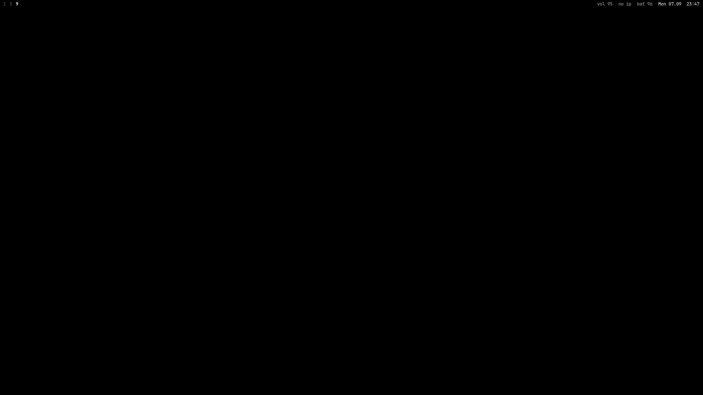
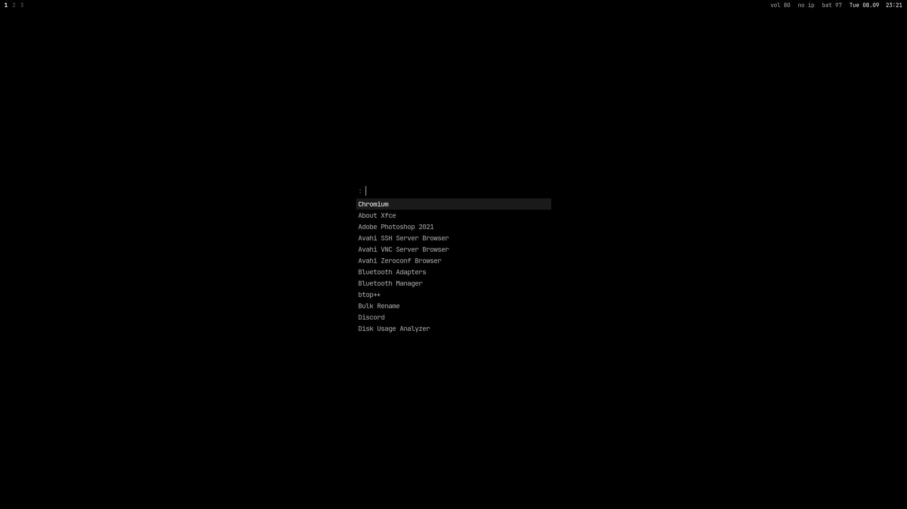
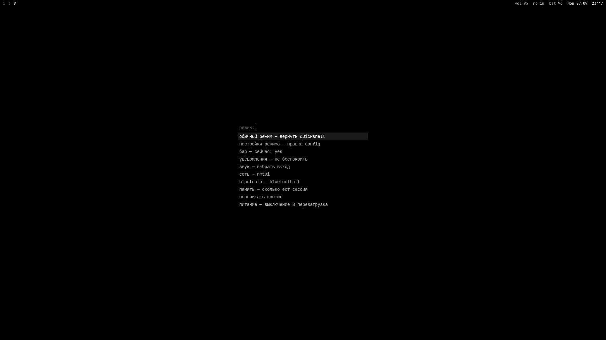
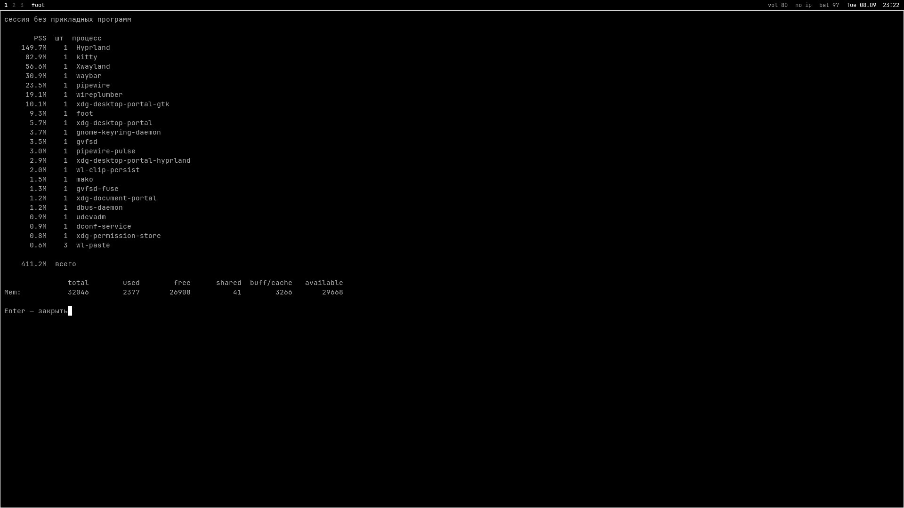

# Guide

<sub>[README](../README.md) · English · [Русский](GUIDE.ru.md) · [What changed](UPDATE.md) · [Desktop notes](DESKTOP.md)</sub>

## What this is

A complete daily-driver desktop configuration for [Hyprland](https://hypr.land): window manager,
status bar, launcher, clipboard history, notifications, on-screen display, lock screen, terminal,
file manager and shell. Every colour in the system is derived from the current wallpaper by
[matugen](https://github.com/InioX/matugen) (Material You), so the desktop is never out of sync
with what is on the screen.

The shell is Quickshell throughout — bar, launcher, clipboard, notifications, volume and
brightness OSD, wallpaper picker, overview and power menu are all one process.

A watchdog supervises it: if Quickshell dies it is restarted, and after three failures in a row it
stops retrying and says so in a notification instead of flapping. `shell-switch status` reports
the current state, `shell-switch restart` reloads it.

## From a blank disk

A full walk-through, from an empty drive to this desktop. If Arch or Artix is already installed,
skip straight to [Install](#install). Commands marked **Arch** or **Artix** differ between the two;
everything else is the same.

<details>
<summary><b>1. Boot the installer</b> — <sub>ISO, USB stick, firmware settings</sub></summary>


* **Arch** — download the ISO from [archlinux.org/download](https://archlinux.org/download/).
* **Artix** — download the **base OpenRC** ISO from [artixlinux.org/download](https://artixlinux.org/download.php).

Write it to a USB stick (everything on the stick is erased):

```bash
sudo dd if=archlinux-x86_64.iso of=/dev/sdX bs=4M status=progress oflag=sync
```

On Windows use [Rufus](https://rufus.ie) in DD mode, or drop the ISO on a [Ventoy](https://www.ventoy.net) stick.

In the firmware (usually `F2`, `F10`, `Del` or `Esc` at power-on): boot in **UEFI** mode, turn
**Secure Boot off**, and on laptops with NVIDIA graphics set the GPU mode to *Hybrid* / *MSHybrid*
rather than *iGPU only*. Boot from the stick.

Check that the machine really booted in UEFI mode — this must print a number, not an error:

```bash
cat /sys/firmware/efi/fw_platform_size
```

</details>

<details>
<summary><b>2. Network, keyboard, clock</b></summary>


Wired Ethernet works by itself. For Wi-Fi:

**Arch**

```bash
iwctl
[iwd]# device list
[iwd]# station wlan0 scan
[iwd]# station wlan0 get-networks
[iwd]# station wlan0 connect "NetworkName"
[iwd]# exit
```

**Artix** (log in as `root`, password `artix`)

```bash
rfkill unblock wifi
connmanctl
connmanctl> enable wifi
connmanctl> scan wifi
connmanctl> services
connmanctl> agent on
connmanctl> connect wifi_xxxxxxxx_managed_psk
connmanctl> quit
```

Then check it and sync the clock:

```bash
ping -c 3 archlinux.org
timedatectl set-ntp true        # Arch only; Artix syncs the clock later from the installed system
```

</details>

<details>
<summary><b>3. Partition and format</b> — <sub>EFI + root, ext4 or btrfs</sub></summary>


Find the disk (`nvme0n1`, `sda`, …):

```bash
lsblk
```

> ⚠️ The next step **erases the whole disk**. Double-check the name.

```bash
cfdisk /dev/nvme0n1
```

Choose `gpt` and create two partitions:

| Partition | Size | Type |
| --- | --- | --- |
| `/dev/nvme0n1p1` | 1G | EFI System |
| `/dev/nvme0n1p2` | the rest | Linux filesystem |

Format and mount them (on a SATA disk the names are `sda1`, `sda2`):

```bash
mkfs.fat -F 32 /dev/nvme0n1p1
mkfs.ext4 /dev/nvme0n1p2

mount /dev/nvme0n1p2 /mnt
mount --mkdir /dev/nvme0n1p1 /mnt/boot
```

Swap is optional — a swap file can be added later, or use `zram-generator` (Arch) / `zramen` (Artix).

</details>

<details>
<summary><b>4. Install the base system</b> — <sub>pick the microcode for your CPU</sub></summary>


The microcode package depends on the **processor**:

| CPU | Package |
| --- | --- |
| Intel | `intel-ucode` |
| AMD | `amd-ucode` |

**Arch**

```bash
pacstrap -K /mnt base base-devel linux linux-headers linux-firmware \
    intel-ucode networkmanager sudo git nano
genfstab -U /mnt >> /mnt/etc/fstab
arch-chroot /mnt
```

**Artix**

```bash
basestrap /mnt base base-devel openrc elogind-openrc linux linux-headers linux-firmware \
    intel-ucode networkmanager networkmanager-openrc sudo git nano
fstabgen -U /mnt >> /mnt/etc/fstab
artix-chroot /mnt
```

Replace `intel-ucode` with `amd-ucode` on an AMD processor.

</details>

<details>
<summary><b>5. Configure the system</b> — <sub>time zone, locale, user, bootloader</sub></summary>


Everything below runs inside the chroot. Replace `Europe/Kyiv`, `myhost` and `user` with your own.

```bash
ln -sf /usr/share/zoneinfo/Europe/Kyiv /etc/localtime
hwclock --systohc

sed -i 's/^#en_US.UTF-8/en_US.UTF-8/; s/^#ru_RU.UTF-8/ru_RU.UTF-8/' /etc/locale.gen
locale-gen
echo 'LANG=en_US.UTF-8' > /etc/locale.conf

echo myhost > /etc/hostname
```

**Artix** also keeps the hostname for OpenRC:

```bash
echo 'hostname="myhost"' > /etc/conf.d/hostname
```

Root password, your user, and `sudo` for the `wheel` group:

```bash
passwd
useradd -m -G wheel,video,audio,input -s /bin/bash user
passwd user
EDITOR=nano visudo        # uncomment the line:  %wheel ALL=(ALL:ALL) ALL
```

Bootloader (GRUB picks up the microcode automatically):

```bash
pacman -S grub efibootmgr
grub-install --target=x86_64-efi --efi-directory=/boot --bootloader-id=GRUB
grub-mkconfig -o /boot/grub/grub.cfg
```

Turn on the network for the installed system:

```bash
systemctl enable NetworkManager          # Arch
rc-update add NetworkManager default     # Artix
```

Leave and reboot, pulling the USB stick out:

```bash
exit
umount -R /mnt
reboot
```

Log in as your user. Wi-Fi from now on: `nmtui`.

</details>

<details>
<summary><b>6. Artix: Arch repositories</b> — <sub>Artix only, needed for Hyprland and Quickshell</sub></summary>


Hyprland, Quickshell and part of the dependencies come from Arch's `[extra]`. Artix has an
official bridge for that:

```bash
sudo pacman -S artix-archlinux-support
sudo pacman-key --populate archlinux
```

Append to the **end** of `/etc/pacman.conf` (after the Artix repositories):

```ini
[extra]
Include = /etc/pacman.d/mirrorlist-arch

[multilib]
Include = /etc/pacman.d/mirrorlist-arch
```

Also uncomment `[lib32]` in the same file, then refresh:

```bash
sudo pacman -Syu
```

The installer stops with a clear message if `[extra]` is missing.

</details>

<details>
<summary><b>7. Graphics drivers</b> — <sub>NVIDIA, AMD, Intel, hybrid laptops</sub></summary>


Not sure what is inside?

```bash
lspci -k | grep -EA3 'VGA|3D|Display'
```

Enable `[multilib]` (Arch: uncomment it in `/etc/pacman.conf`; Artix: done in step 6) so the
32-bit libraries for Steam and Wine are available, then `sudo pacman -Syu`.

**AMD Radeon**

```bash
sudo pacman -S mesa lib32-mesa vulkan-radeon lib32-vulkan-radeon
```

Video decoding (VA-API) is built into `mesa`. Nothing else is needed — the kernel driver `amdgpu`
loads by itself.

**Intel**

```bash
sudo pacman -S mesa lib32-mesa vulkan-intel lib32-vulkan-intel intel-media-driver
```

`intel-media-driver` covers Broadwell (5th gen) and newer; for older chips install
`libva-intel-driver` instead.

**NVIDIA**

Pick the package by the card generation:

| Card | Package |
| --- | --- |
| RTX 50/40/30/20, GTX 16xx (Turing and newer) | `nvidia-open` (`nvidia-open-dkms` for `linux-lts`, `linux-zen` and other kernels) |
| GTX 10xx, GTX 9xx (Pascal, Maxwell) | `nvidia-580xx-dkms` + `nvidia-580xx-utils` from the AUR (instead of the line below) |
| older | not supported by Hyprland — use the iGPU or `nouveau` |

```bash
sudo pacman -S nvidia-open nvidia-utils lib32-nvidia-utils egl-wayland libva-nvidia-driver
```

Load the driver early so Hyprland gets the GPU from the very first frame. In
`/etc/mkinitcpio.conf` set:

```bash
MODULES=(nvidia nvidia_modeset nvidia_uvm nvidia_drm)
```

and remove `kms` from the `HOOKS=(...)` line, then rebuild and reboot:

```bash
sudo mkinitcpio -P
sudo reboot
```

Check that DRM modesetting is on — it must print `Y`:

```bash
cat /sys/module/nvidia_drm/parameters/modeset
```

If it prints `N`, add `nvidia_drm.modeset=1` to `GRUB_CMDLINE_LINUX_DEFAULT` in
`/etc/default/grub` and run `sudo grub-mkconfig -o /boot/grub/grub.cfg`.

**Hybrid laptops (Intel/AMD + NVIDIA)** — install the drivers for **both** GPUs. The desktop runs
on the integrated one and the NVIDIA card wakes up for games (`prime-run <game>` from the
`nvidia-prime` package).

You do not have to edit anything by hand afterwards: the installer looks at `lspci`, keeps the
NVIDIA environment in `~/.config/hypr/config/env.conf` only when there is an NVIDIA card, and
switches VA-API to `radeonsi` or `iHD` on AMD and Intel.

</details>

<details>
<summary><b>8. Processor</b> — <sub>Intel and AMD power management</sub></summary>


Microcode was installed in step 4. After it, check it loaded:

```bash
journalctl -k | grep -i microcode       # Arch
dmesg | grep -i microcode               # Artix
```

* **AMD** (Zen 2 and newer) uses the `amd-pstate` driver automatically on current kernels —
  `cat /sys/devices/system/cpu/cpu0/cpufreq/scaling_driver` prints `amd-pstate-epp`.
* **Intel** uses `intel_pstate`, also automatic.

Laptops: install a power daemon so the island can switch power profiles:

```bash
sudo pacman -S power-profiles-daemon
sudo systemctl enable --now power-profiles-daemon          # Arch
sudo pacman -S power-profiles-daemon-openrc && \
    sudo rc-update add power-profiles-daemon default       # Artix
```

</details>

<details>
<summary><b>9. Install this configuration</b></summary>


As your normal user (not root), with the network up:

```bash
bash <(curl -fsSL https://raw.githubusercontent.com/fedyaqq34356/hyprdots/main/install.sh)
```

The installer detects Arch or Artix and your GPU, installs every package (plus `yay` for the AUR if
there is no AUR helper yet), enables NetworkManager and Bluetooth for systemd or OpenRC, deploys the
files, sets zsh as the login shell and builds the colour scheme.

Put a few images into `~/Pictures/Wallpapers`, then log out and back in on the TTY and start the
session:

```bash
start-hyprland
```

To start it automatically after logging in on tty1, add to the end of `~/.zprofile`:

```bash
[[ -z $WAYLAND_DISPLAY && $(tty) == /dev/tty1 ]] && exec start-hyprland
```

First steps: `Super` + `W` — pick a wallpaper, `Super` + `D` — launcher, `Super` + `Shift` + `I` —
tune the island. All shortcuts are in [Keybindings](#keybindings).

</details>

## Install

One command. It fetches the repository, installs every dependency, backs up whatever is already
in place and generates the colour scheme:

```bash
bash <(curl -fsSL https://raw.githubusercontent.com/fedyaqq34356/hyprdots/main/install.sh)
```

Or, from a clone:

```bash
git clone https://github.com/fedyaqq34356/hyprdots.git
cd hyprdots
./install.sh
```

| Flag | Effect |
| --- | --- |
| `--dry-run` | print every action, change nothing |
| `--no-packages` | deploy the configuration only, install no packages |
| `--games` / `--no-games` | Steam, gamemode and MangoHud (on by default on desktops) |
| `--printer` / `--no-printer` | Canon LBP6000 over CUPS + CAPT (on when it is plugged in) |
| `--pulse-elite` / `--no-pulse-elite` | the author's PlayStation Pulse Elite headset profile (off unless that headset is paired) |
| `--update` | pull the latest revision and refresh an existing install |
| `-y`, `--yes` | do not ask for confirmation |

The installer requires `pacman`, must be run as a normal user (not root), and copies the previous
configuration to `~/.config/dotfiles-backup-<timestamp>` before writing anything.

Both init systems are handled: on Arch with systemd the services are enabled with `systemctl` and zram
comes from `zram-generator`; on Artix the OpenRC scripts are installed instead.

### Uninstall

```bash
bash ~/.local/share/hyprdots/uninstall.sh      # or ./uninstall.sh from your clone
```

Every file the installer wrote is moved to `~/.config/hyprdots-removed-<timestamp>`, and the
configuration you had before the first install is put back from its backup. `--system` also removes
the root helpers (sudoers rules, zram, the amdgpu initramfs drop-in), `--dry-run` shows the plan.
Packages stay installed.

<details>
<summary><b>Layout</b> — <sub>where each piece lives</sub></summary>

| Path | What is there |
| --- | --- |
| `config/hypr/hyprland.lua` | entry point on Hyprland 0.55+; loads `config/hypr/cfg/` — window motion runs on real springs |
| `config/hypr/cfg/` | the Lua config: `animations`, `binds`, `rules`, `look`, `startup`, `env`, the black mode |
| `config/hypr/hyprland.conf` | hyprlang entry point, used on Hyprland older than 0.55; the installer picks one |
| `config/hypr/config/` | hyprlang files, one per topic; the Lua config reads `env`, `monitors`, `colors`, `shape` and the mode link from here too |
| `config/hypr/scripts/audio/` | volume, the microphone level lock, WirePlumber start |
| `config/hypr/scripts/capture/` | screenshots, screen recording, image upscaling |
| `config/hypr/scripts/clipboard/` | history store, guard, wipe, island preview |
| `config/hypr/scripts/lock/` | the lock screen, its status lines and the idle guard |
| `config/hypr/scripts/notify/` | missed-notification counter, D-Bus test and trace helpers |
| `config/hypr/scripts/print/` | the print panel backend; `print/print-root/` holds the root-side files |
| `config/hypr/scripts/system/` | cache cleanup, updates, monitor fix, sysmon, focus mode, power menu |
| `config/hypr/scripts/theme/` | palette generators for browsers, cursors, Kvantum, LibreOffice, icons, sounds |
| `config/hypr/scripts/tools/` | calculator, file lists, downloads sorter, git activity |
| `config/hypr/scripts/wallpaper/` | setting, rotating, indexing and picking wallpapers |
| `config/quickshell/f/` | the shell: `bar`, `panels`, `overlays`, `desk`, `services`, `design`, `reusables`, `lang` |
| `config/matugen/` | templates the palette is rendered into |
| `bin/` | commands that land in `~/.local/bin` |
| `home/` | dotfiles that land in `~` |
| `extras/` | optional pieces the installer does not deploy |

Machine state stays out of the config: the microphone level and the lock choice live in
`~/.local/state/hypr/`. An update moves them there and removes the old flat copies of the scripts.

</details>

<details>
<summary><b>Updating</b> — <sub>one command, and what it will not overwrite</sub></summary>


Already installed? Do not run the installer again — there is an update path that keeps your
machine as it is and only brings the configuration forward:

```bash
dots-update
```

**Or just press the button.** The shell checks GitHub every 30 minutes. When a new version is
out, an **update** button with its size appears next to the workspaces — or in the top-left corner
when the island has taken over the bar. Clicking it opens a terminal with the list of changes, the
number of files and how much the update weighs, and asks `Update now? [y/N]`. Say no and the
terminal closes while the button stays; say yes and the update runs by itself, after which the
button disappears until the next version.

It pulls the newest revision, prints the commits you are about to get, replaces the configuration
files (backing up whatever it overwrites), installs only packages that are genuinely missing —
never a full system upgrade — regenerates the palette from your current wallpaper and reloads
Hyprland and the bar in place. No logout needed.

From a clone, the same thing:

```bash
cd hyprdots && ./install.sh --update
```

`--dry-run` works here too and prints every step without touching anything.

</details>

<details>
<summary><b>Theming</b> — <sub>how a wallpaper becomes a palette, and where each template lands</sub></summary>


```
wallpaper ──▶ matugen ──┬──▶ hyprland   window borders
                        ├──▶ hyprlock   lock screen
                        ├──▶ quickshell bar, launcher, OSD
                        ├──▶ kitty      terminal palette
                        ├──▶ rofi       launcher
                        ├──▶ dunst      notifications
                        ├──▶ gtk 3/4    Thunar and every other GTK app
                        ├──▶ papirus    folder icons tinted to the accent
                        ├──▶ wlogout    power menu
                        ├──▶ sddm       login screen
                        └──▶ cava       audio visualiser
```

`~/.config/hypr/scripts/wallpaper/set-wallpaper.sh` is the single entry point: it paints every connected
monitor, persists the choice to `~/.config/hypr/current-wallpaper`, and re-runs matugen. Templates
live in `~/.config/matugen/templates` — add a file there plus one block in
`~/.config/matugen/config.toml` and any other application joins the scheme.

The lock screen reads the same source. `Super+Shift+L` runs a wrapper that regenerates the palette
if the wallpaper has changed since the last run, so the lock screen always shows the wallpaper that
is on the desktop right now — blurred and dimmed, with the avatar, the clock in handwritten strokes
and the date above the password field.

The field is a field: a pill with a lock glyph, one dot per character typed, a submit arrow that
becomes a spinner while PAM is thinking, and the keyboard layout and a Caps Lock warning underneath.
A wrong password fades the field out and back rather than shaking it, and says what was wrong. What
is playing sits in one corner, missed notifications in another.

</details>

<details>
<summary><b>Hardware video decoding</b> — <sub>NVIDIA, VA-API and the browser flags that actually matter</sub></summary>


The session already exports `LIBVA_DRIVER_NAME=nvidia` and `NVD_BACKEND=direct`, which is only
half the story: NVIDIA needs `libva-nvidia-driver` to map VA-API onto NVDEC, and each browser has
to be told to use it.

Chromium wants the flags on its command line — the packaged binary is not a wrapper script, so
there is no `chromium-flags.conf` to edit; copy the desktop entry to
`~/.local/share/applications/` and add:

```
--ozone-platform-hint=auto --enable-features=VaapiVideoDecodeLinuxGL,VaapiIgnoreDriverChecks,AcceleratedVideoDecodeLinuxGL --ignore-gpu-blocklist --enable-gpu-rasterization --enable-zero-copy --use-gl=angle --use-angle=gl
```

Firefox and LibreWolf want a `user.js` in the active profile:

```js
user_pref("media.ffmpeg.vaapi.enabled", true);
user_pref("media.hardware-video-decoding.force-enabled", true);
user_pref("widget.dmabuf.force-enabled", true);
user_pref("gfx.webrender.all", true);
user_pref("media.av1.enabled", false);
```

plus `MOZ_DISABLE_RDD_SANDBOX=1` in the environment, otherwise the decoder process cannot reach
the driver. Turning AV1 off is deliberate on older cards: Pascal and earlier have no AV1 decoder,
so accepting those streams quietly moves the work back to the CPU.

Check the result in `chrome://gpu` and `about:support`, or watch `nvidia-smi dmon` while a video
plays — the `dec` column stays at zero when decoding is still on the CPU.

</details>

<details>
<summary><b>Idle</b> — <sub>timers in the shell, the decision in one guard script</sub></summary>


The shell locks the session after 50 minutes without input and turns the panels off five minutes
later. Both timers live in the shell's own settings rather than in a third config file with its own
syntax, and both actions still go through `config/hypr/scripts/lock/idle-guard.sh`, which refuses to fire
while a window is fullscreen, audio is genuinely playing (uncorked, not merely holding the device
open), a recording is running, or any process named in `~/.config/hypr/idle-inhibit.list` is alive.

Keeping that decision in the script is deliberate: it already knows every reason not to lock, and a
second opinion written in QML would only end up disagreeing with it.

That list is matched against process names with `pgrep -x`, one per line. Only
`idle-inhibit.list.example` is tracked; copy it and add whatever should keep your own screen awake
— the working copy is deliberately kept out of the repository.

The outbound-connection ignore list works the same way: `outbound-ignore.list.example` is tracked,
the working copy is not, because what a person runs is nobody else's business.

`hypridle` is no longer started; the line is left commented in `config/hypr/config/startup.conf` for
anyone who wants it back.

</details>

<details>
<summary><b>Power menu</b> — <sub>why it is a panel and not a script</sub></summary>


`Super`+`P` opens a native Quickshell screen: five round buttons in a row — lock, sleep, log out,
reboot, shut down — and one glowing lens that glides under the selected one. Picking an action
spreads the lens over the whole screen and fades it into the background before the session goes.
`l`, `s`, `e`, `r` and `p` fire straight away; arrows move the selection, `Enter` confirms,
`Escape` or a click outside closes. The previous tile menu stays bound as
`quickshell:powerMenuClassic`.

It takes its colours from the wallpaper like everything else. `wlogout` is still themed from the
same palette and stays available as a standalone power menu.

</details>

<details>
<summary><b>Login screen</b> — <sub>SDDM on the desktop wallpaper</sub></summary>


`extras/sddm` is an SDDM theme in the same style: the current wallpaper under a soft blur, the
matugen palette, a large clock, the avatar from `~/.face` and one glass password field. On a
successful login the blur lifts, so the screen hands over to the exact wallpaper the desktop opens on.

```sh
sudo extras/sddm/install.sh      # copy the theme and select it
sudo extras/sddm/uninstall.sh    # remove it
```

The wallpaper, palette and avatar live in `/var/lib/f-sddm`, owned by the user.
`set-wallpaper.sh` refreshes them through `sddm-sync.sh` on every wallpaper change, so the login
screen follows the desktop without sudo.

</details>

<details>
<summary><b>Screen capture</b> — <sub>region, window, monitor, colour picker, OCR</sub></summary>


`config/hypr/scripts/capture/screenshot.sh` takes one argument and covers every case:

| Mode | What it grabs |
| --- | --- |
| `region` | an area drawn with the mouse |
| `window` | one window, snapped to its real geometry |
| `output` | the monitor under the cursor |
| `all` | every connected monitor in one image |
| `edit` | an area, then [satty](https://github.com/gabm/Satty) for arrows and blur |
| `color` | the colour under the cursor, hex into the clipboard |
| `ocr` | an area, its text recognised and copied — no image is kept |

The screen is frozen with `hyprpicker -r -z` while the selection is being drawn, so menus and
animations stay where they are. Every shot goes to `~/Pictures/Screenshots` **and** to the
clipboard, and the notification carries the image as its own thumbnail. Set `SCREENSHOT_DIR` to
save somewhere else.

</details>

<details>
<summary><b>Screen recording</b> — <sub>monitor or region, with system audio</sub></summary>


`config/hypr/scripts/capture/record-toggle.sh` toggles: the first call starts, the second stops, whatever
mode started it.

| Argument | Effect |
| --- | --- |
| `screen` | the monitor under the cursor (default) |
| `region` | an area drawn with the mouse |
| `--mic` | record the microphone instead of the system output |
| `--no-audio` | video only |

By default the system output is recorded through the monitor source of the default sink, so a
recording carries the sound you actually heard. Files go to `~/Videos` (`RECORD_DIR` overrides it),
and the path of the finished file lands in the clipboard.

While something is being recorded the bar shows a pulsing red dot and the elapsed time — click it
to stop.

</details>

<details open>
<summary><b>The dynamic island</b> — <sub>one pill in place of the clock that turns into whatever is happening</sub></summary>


The island sits in the middle of the bar where the clock was, and by default the bar gives it the
whole row: the zones step aside, the space stays reserved. At rest it is a narrow pill with the
clock, or with the workspace dots when nothing else is going on — the active dot carries the
workspace number inside it.

Everything else happens by growing out of that pill. Width and height move on springs, content
slides in from below while the old content leaves upward, and every event gives the island a small
bump first — the body answers before the shape does.

**What it shows**, most important first: a ringing alarm → screen recording → volume and brightness →
a new notification → a running timer → music → the clock. Each source can be switched off on its
own.

- **Music** — the album cover with a radial spectrum sits in the right corner while the clock stays
  in the middle. Hover the island and it opens into a player card: title, artist, a seek bar,
  previous / play / next. The waveform and the edge glow take the colour of the cover art.
- **Notifications** unfold into a card with the app icon, the sender and two lines of text, then fold
  back. While the island shows them, the ordinary popup is not drawn a second time.
- **Timers** move into a left slot beside the pill — a ring that fills, the last minute in digits.
  When one ends, the island opens red with snooze and dismiss. A print job takes the same slot while
  the printer works.
- **Volume, brightness, layout, workspace** — a one-line event that swaps in for a moment and leaves.
- **Headphones, a charger, a low battery, a mouse or keyboard running low, Wi-Fi and VPN** — each
  gets its own small scene: a charge ring, a battery that fills, a fan that finds the network.

Swipe the open island upward to close it; hover will not reopen it until the cursor leaves.

`Super` + `Shift` + `I` opens its settings: shape (none / pill / card), inside the bar or floating,
top or bottom edge, alignment, which monitor, offsets, the size of both shapes, fill, per-event
colour, how long events stay and how long it waits before opening. Every knob applies live.

To see every scene without the hardware: `qs -c f ipc call island play bt` (also `btoff`, `power`,
`low`, `peri`, `net`, `vpn`, `notif`, `osd`); `qs -c f ipc call island pin true` keeps it open.

</details>

<details>
<summary><b>The bar</b> — <sub>what every island is and why it is there</sub></summary>


Workspaces on the left, clock in the middle, and on the right three groups divided by hairlines:
the recording indicator and the tray; Wi-Fi, microphone and volume; keyboard layout and battery.
Contrast follows how often something is read — battery and layout carry it, glyphs stay at 75%
opacity, and only a problem state takes colour, so a dropped Wi-Fi link or a muted microphone is
the one thing that stands out. The layout badge (`EN` / `RU` / `UA` …) follows
`Alt`+`Shift` and can also be clicked to cycle layouts.

`Super`+`Shift`+`M` opens the audio panel on the same orbit view: the current output sits in the
middle with its volume drawn as an arc around it, and every other sink circles it. Click a device to
make it the default, roll the wheel over it to set that device's own volume, or over the core for
the current one. `Tab` switches between outputs and inputs, `+`/`-` change the level, `M` mutes,
`Escape` closes.

Folder icons follow as well. Papirus ships one folder set per colour, and
`config/hypr/scripts/theme/papirus-tint.py` picks whichever is closest to the current accent in CIE Lab
and builds a small user icon theme that inherits Papirus-Dark and overrides only the folders — no
root, no touching `/usr/share`. It runs from a matugen hook, so a new wallpaper repaints the
folders with everything else.

Clicking the Wi-Fi glyph, or `Super`+`N`, opens the network panel, and `Super`+`B` opens it on the
Bluetooth tab. Both share one view: whatever you are connected to burns in the middle, and the
alternatives orbit it on two tilted rings — the stronger the signal, the closer in and the faster
it travels. Hovering a chip stops the rotation and prints the full detail under the graph, since a
96-pixel chip cannot hold a link rate and a MAC address. Clicking connects; a secured network opens
a password field; clicking the active one disconnects.

The ring radii, the chip size and the tilt are not a taste decision — the combination was checked by
exhaustive search, so no two chips can overlap at any pair of ring rotations. Beyond the eight
orbit slots the panel switches to a plain list with the same rows, and the footer says how many were
left out. Wi-Fi drives `nmcli` and refreshes off `nmcli monitor`; Bluetooth talks to BlueZ over
D-Bus, so battery levels and pairing state arrive as they change rather than on a poll.

Next to the workspaces sits the player: album art and a spectrum drawn by a second `cava` instance
reading raw levels off pipewire. The track name lives in the tooltip and in the panel instead of
scrolling in the bar. Clicking the art pauses, the island opens the player panel, the wheel changes
track. `cava` only runs while something is playing.

Hovering any bar element raises a tooltip under the strip — the bar window is taller than the strip
itself, and its input region is masked to the strip so the empty space passes clicks through to the
windows below. Clicking the clock opens a calendar.

Peripherals with their own battery — mouse, keyboard, headset — appear only once they drop below
40%, since a permanent "mouse charged" glyph is noise. While the launcher is open, the workspace
dots of the highlighted application light up, so a second copy never gets started by accident.

Volume, microphone and brightness all raise the same OSD card at the bottom of the focused screen.
The level is drawn as a travelling wave rather than a bar. While something is playing, the spectrum
from `cava` modulates the wave's local amplitude, so it swells with the music; a player that reports
"playing" while its stream is corked sends nothing but zeros, and the wave fades back to a plain sine
instead of collapsing into a straight line. Muting flattens the wave rather than hiding it.
Brightness goes through `brightnessctl -c backlight`; on machines that expose no backlight device
the OSD says so instead of the keys doing nothing at all.

The clock island has no seconds digits — they are too busy at this size. Instead a stroke walks the
island's own rounded border once a minute, so the movement is there without the mess. Switching
workspaces leaves a short streak between the old and new dot which retracts toward the destination,
so the eye follows the move rather than hunting for the active dot again. The album art sits inside
a thin arc showing the track position, which spends no width on a progress bar or a timestamp. A VPN
dot appears next to the network glyph only while a tunnel is up: detection is local and cheap, and
the exit address is fetched when the tunnel state changes or the dot is clicked, never on a timer.
At session start the islands drop in from above with a stagger, left to right, so the bar assembles
instead of appearing all at once.

</details>

<details>
<summary><b>Widgets</b> — <sub>system rings, the commit heatmap, notifications, focus mode</sub></summary>


**System rings** — `Super` + `F1` opens six thin arcs: CPU, RAM, temperature, GPU, VRAM and GPU
temperature. Each arc walks from accent to red as its load rises, and a dot rides the head. The whole
panel lives inside an inactive loader: while it is closed there is no window, no canvas, no timer and
no polling process, which keeps a widget that is glanced at a few times a day from querying
`nvidia-smi` around the clock. Hardware the machine does not have shows `n/a` rather than a
fabricated zero.

**Processes** — `Ctrl` + `Shift` + `Esc` pours one card out of the island: the heaviest app, its
CPU, memory and uptime, and a CPU graph that flows like water under it. Arrows, the wheel or typing a
name move to another app; hold `Enter` (or press and hold the icon) to close it. The app is asked to
quit first and only killed if it is still there three seconds later. Processes are grouped by app,
only your own are listed, and the session itself — Hyprland, the shell, PipeWire, portals — is locked.
Clicking the CPU orb on `Super` + `F1` opens it on whatever is using the CPU right now.

**Calendar heatmap** — day cells are shaded by how many commits were made that day, across every git
repository under `$HOME`. `git-activity.py` counts them into a JSON cache once an hour; the calendar
only reads it, so the panel never blocks on a filesystem walk. The scale is a square root rather than
linear: one commit should be visible, and the difference between twenty and thirty should not be.

**Notifications** — cards slide in from the right and leave the same way. The remaining lifetime is
drawn as a stroke retreating around the card's own rounded border, so the countdown is part of the
shape instead of a separate progress bar. Hovering pauses it. Critical notifications keep a static
border and wait for a click. Each card plays a generated sound: `gen-notify-sounds.py` synthesises a
soft struck-bar blip for normal ones, a lower falling pair for critical ones, and a dry knock for
hitting either end of the volume range. Nothing is shipped as a binary — retune the note tables and
re-run the script.

**Focus mode** — `Super` + `Ctrl` + `F` pushes everything except the active window into shadow:
inactive windows dim hard, blur drops a pass, and the animated border gradient stops. Toggling back
restores the values by name rather than reloading the whole config, so unsaved experiments survive.

</details>

<details>
<summary><b>Theming, at runtime</b> — <sub>why the palette is not a QML file any more</sub></summary>


matugen used to generate `Colors.qml` directly. Writing a QML file made Quickshell reload the entire
configuration on every wallpaper change: every object was rebuilt, so the colours could only ever
snap over. The palette now lands in `~/.cache/matugen/colors.json`, outside the config directory, and
`Colors.qml` is a hand-written singleton that watches that file and eases each colour into its new
value over about two thirds of a second. The accents lag the surfaces slightly, which reads as the
scheme rebuilding itself rather than as a filter dropped over everything at once.

The pointer follows the wallpaper too. `gen-cursor-theme.py` reads the palette, draws twelve cursor
shapes as SVG, and builds them into a hyprcursor theme with `hyprcursor-util`. Every shape is a thick
outline in the background colour under a fill in the accent, so it stays readable on a white page and
in a dark terminal alike. X11 aliases are declared, so GTK and Qt applications pick it up. XWayland
still needs an Xcursor build of the same theme, which `hyprcursor-util` cannot produce.

</details>

<details>
<summary><b>Desktop widgets</b> — <sub>the wallpaper layer, its editor, and the faces each widget has</sub></summary>


`Super` + `Shift` + `W` lifts the wallpaper layer into an editable state: a grid appears, widgets can
be dragged, the wheel resizes them, and a palette along the bottom adds more. Outside that mode the
layer carries an empty input mask, so clicks, drags and scrolls pass straight through to whatever is
behind it — the widgets are visible and completely intangible.

Positions are stored as fractions of the screen rather than pixels, so a layout arranged on a laptop
panel lands in the same place on an external monitor. Each widget has faces to switch between:

| Widget | Faces |
| --- | --- |
| clock | two stacked numerals, a line with the date, or handwritten strokes |
| music | sleeve with title and seek line, or the record itself, turning while it plays |
| weather | a card with a three day strip, or just a glyph and a number |
| system | rings, labelled bars, bare digits, all six meters as a card, vertical gauges, or two columns |
| visualiser | bars, wave, wreath, a mirrored row, or a dot matrix |
| screen time | today's applications as bars, or the total alone |
| disks | mount points with fill bars, or free space in figures |
| network | download and upload, or a card with the network and its link rate |
| notifications | the last few, or the unread count |
| updates | the count, or the first six package names |

Missing album art draws a record — grooves, a rotating highlight, a blank paper label — because "no
cover" is the normal case for streams and radio, and a lone music glyph reads as a broken image.

The layer stops existing while a window covers it. A tiled or fullscreen window hides the wallpaper
entirely, and a widget nobody can see still costs frames: the visualiser repaints sixty times a
second behind someone else's window, and cava keeps streaming for it. Floating windows do not count
— they are exactly the case the desktop is kept visible for.

</details>

<details>
<summary><b>Bar builder</b> — <sub>the bar as data, not as a file</sub></summary>


`Super` + `Shift` + `J` opens the bar's own editor. Three zones, any number of islands per zone, any
number of modules per island — dragged into order, moved between zones, switched off, configured.
Nothing about the layout lives in QML any more; it is a JSON file the builder writes.

Thirty-three modules ship: workspaces, music, clock, date, tray, Wi-Fi, Bluetooth, VPN, network
speed, volume, microphone, battery, keyboard layout, brightness, peripherals, screen recording,
outbound connections, updates, notifications, do-not-disturb, CPU, RAM, GPU, VRAM, both
temperatures, disk, weather, uptime, timer, separator, spacer, custom text and a custom command
— the last one runs on an interval and can act on a click.

A second tab holds the look: bar and island height, margins, gaps, padding, corner radius, font and
glyph size, fill and hover opacity, border alpha, shadow, border, the entrance animation, hover
growth and tooltips. The defaults reproduce the previous hand-written bar module for module, so
opening the builder and changing nothing changes nothing.

Adding a module to the shell means one component in `Modules.qml` and one line in the registry; the
builder picks it up on its own, options and all.

</details>

<details>
<summary><b>Settings</b> — <sub>one card, one flag per feature</sub></summary>


`Super` + `Shift` + `P` opens one card of switches. Every optional surface of the shell — sounds,
desktop widgets, dock, drawing, screen time, the authorisation agent, idle handling — is one row
here, one flag in `Prefs`, and one loader in `shell.qml`. Turning something off costs nothing at
runtime; removing it means deleting its files and one line.

The same card carries the interface language, the bar's edge, the heading font and the notification
tone, each previewed on selection.

</details>

<details>
<summary><b>Sounds</b> — <sub>a sample per gesture, and why they are fired and forgotten</sub></summary>


Every gesture in the shell has a sound: a click for buttons, a heavier one for anything that commits,
distinct stingers for a panel opening and closing, a ratchet under a dragging finger, connect and
disconnect for the radios. Playback is fire-and-forget through `execDetached`, one process per
sample, because a single shared process can only hold one child — the second sound would cut the
first off mid-note.

Volume and the notification tone are in the settings; the whole set is one switch away from silence.

</details>

<details>
<summary><b>Equaliser</b> — <sub>PipeWire biquads, the curve, the spectrum behind it</sub></summary>


`Super` + `Shift` + `Q` opens ten bands built on PipeWire's own biquad filters — no EasyEffects, no
plugin packs, no second sound daemon. The graph is declared in
`config/pipewire/pipewire.conf.d/99-shell-eq.conf` and read when PipeWire starts; gains after that
are pushed live, one `pw-cli` call per change.

Two things share the same grid: the curve the bands make, and the live spectrum behind it while
something is playing. The sliders say what you asked for, the spectrum says whether there is anything
there to lift, and the curve over it shows where your hand landed relative to the music. Handles sit
on the curve rather than on a separate strip, and a double click returns one band to zero.

Presets: flat, bass, treble, vocal, pop, rock, jazz, classic, and a night curve that lifts both ends
for quiet listening.

</details>

<details>
<summary><b>Screen time</b> — <sub>counted in the shell, paused when locked, kept for two weeks</sub></summary>


Counted in the shell rather than by a background daemon: the shell already knows which toplevel is
focused, so a separate process would only duplicate that and then disagree with it. A coarse 15
second tick is enough for the shape of a day and cheap enough to leave running forever.

Counting stops while the session is locked and while the screen is off. History is kept for two
weeks, in `~/.local/state/quickshell/`, and never leaves the machine.

</details>

<details>
<summary><b>Authorisation</b> — <sub>the shell's own polkit prompt</sub></summary>


The shell draws its own polkit prompt. Without one, an unrelated agent draws it — a different font, a
different radius, a different idea of what a dialog looks like — at exactly the moment the user is
being asked to trust what is on screen. A wrong password shakes the card rather than only printing a
line of red text.

</details>

<details>
<summary><b>Files</b> — <sub>yazi in kitty, recoloured with everything else</sub></summary>


`Super` + `E` opens yazi inside kitty: image and video previews come through kitty's graphics
protocol as real pixels rather than icons, and the flavour is generated by matugen alongside
everything else, so the file manager recolours with the wallpaper. Thunar stays installed on
`Super` + `Shift` + `Y` for dragging files into other applications, which a terminal cannot do.

</details>

<details>
<summary><b>Languages</b> — <sub>English and Russian, switched without a restart</sub></summary>


The interface ships in English and Russian, switchable in the settings without a restart. Strings
live in `config/quickshell/f/lang/*.json`; plural rules belong to the language, so English supplies
two forms and Russian three. Month and weekday names come from the same tables rather than from Qt's
locale, because the shell's language is its own setting and does not follow `LANG`.

</details>

<details>
<summary><b>Serezha mode</b> — <sub>a black session the shell steps out of</sub></summary>


A second session mode for when the machine has to be fast rather than pretty. Quickshell shuts
down entirely and waybar takes the top edge: white on black, one solid line, no rounding, no
gaps, no animations anywhere — `animations:enabled = false` and the composer's own
`misc:background_color` paints the desktop instead of a wallpaper daemon.

<table>
<tr>
<td></td>
<td></td>
</tr>
<tr>
<td></td>
<td></td>
</tr>
</table>

The shell's panels are replaced by the cheapest thing that answers the same question: fuzzel for
the launcher and for clipboard history, `nmtui` and `bluetoothctl` in a terminal for the network,
mako for notifications, and one fuzzel menu on `Super` + `Shift` + `P` for everything the settings
panel used to hold — including the way back.

Switching in happens in the shell's own settings, held rather than clicked; switching out lives in
the mode's menu, because in this mode there is no shell to hold a settings panel. Both directions
are a symlink and `hyprctl reload`: no logout, and nothing removed from the normal configuration —
`config/hypr/config/mode.conf` points at an empty file or at the black one, and the black one wins
by being sourced last.

Measured with PSS rather than RSS, because summing RSS counts every shared library once per
process, and with scripts counted under their own names rather than hidden behind `bash`: the
session is **259 MB on the defaults**, measured with a browser in a video call holding audio
streams open, against roughly 1005 MB in the normal mode and 302 MB for the same mode before X11
went on demand. Hyprland itself is 147 MB of that, and the NVIDIA driver is a fixed share of it.

The mode used to sit at 532 MB, and these processes held nearly all of what came off:

| | normal mode | black mode | |
| --- | --- | --- | --- |
| terminal | kitty, 210 MB | **foot**, 8 MB | a Python runtime and an OpenGL renderer against C and `wl_shm` |
| files | Thunar, 60 MB | **nnn**, 1 MB | and `tumbler` leaves with it — the thumbnailer read every file in a directory |
| automount | udiskie, 36 MB | **serezha-automount**, 3 MB | `udevadm` and `udisksctl` instead of PyGObject and GTK |
| X11 | Xwayland, 66 MB | **serezha-xlazy**, 0.1 MB | Xwayland starts on the first X11 client — see below |
| bar | waybar, 31 MB | **maybar**, 8 MB | a maintained yambar fork drawing through `wl_shm`, no GTK3 |
| file dialog | portal-gtk, 24 MB | **on demand**, 0 MB | D-Bus brings the backend back on the next dialog |

Thunar leaves for colour as much as for weight: the swapped GTK theme never reaches its sidebar or
its path bar, so it stays grey in a black session. `mimeapps.list` is swapped alongside the themes,
so `xdg-open` follows and a double-clicked folder opens `nnn` rather than bringing Thunar back.

Killing Xwayland is a one-way trade on Hyprland 0.56: the compositor does not bring it back — not
on the first X11 client, not on `hyprctl reload`, not on `xwayland:enabled true`. So the mode takes
X11 away from Hyprland for the rest of the session instead. A small C program,
`serezha-xlazy`, holds the sockets of a free display and sleeps in `poll()`; the first X11 client
wakes it, it `exec`s into `xwayland-satellite` with those sockets, and Xwayland is up a tenth of a
second later. Steam and Wine keep working. On every entry, exit and `serezha-mode reap`, a
satellite with no clients left folds back into the 0.1 MB watcher, so Xwayland only lives while an
X11 window does — in the normal mode too, once the black one has been entered. With X11 windows
already open on the first entry, Xwayland is left alone.

Battery is a separate axis and does not come out of the display. `serezha-power` runs from
`/usr/local/bin` under one passwordless sudo rule for that single path: governor and EPP, the HDA
codec's idle timeout, USB autosuspend outside input devices, SATA ALPM, dirty writeback, Wi-Fi
power save, and the GPU power cap where the card allows one. Every value is saved to `/run` and put
back on the way out. Brightness, volume, refresh rate and idle timeouts are deliberately untouched.

</details>

## Keybindings

`Super` is the modifier.

**Shell**

| Key | Action |
| --- | --- |
| `Super` + `D` | application launcher |
| `Super` + `C` | launcher in calculator mode |
| `Super` + `Tab` | window overview with live thumbnails |
| `Super` + `V` | clipboard history |
| `Super` + `Shift` + `V` | wipe the clipboard and its history |
| `Super` + `W` | wallpaper picker |
| `Super` + `Shift` + `B` | media browser (thumbnail grid) |
| `Super` + `N` | Wi-Fi networks |
| `Super` + `B` | Bluetooth devices |
| `Super` + `A` | media player panel |
| `Super` + `Shift` + `M` | audio panel (output and microphone) |
| `Super` + `Shift` + `D` | calendar with a commit heatmap |
| `Super` + `F1` | system monitor rings |
| `Ctrl` + `Shift` + `Esc` | processes — find and close an app |
| `Super` + `Ctrl` + `B` | battery — charge, time left, health and cycles |
| `Super` + `Shift` + `N` | notification centre |
| `Super` + `Ctrl` + `N` | do not disturb |
| `Super` + `P` | power menu |
| `Super` + `Shift` + `I` | dynamic island settings |
| `Super` + `Shift` + `L` | lock screen |

**Added recently**

| Key | Action |
| --- | --- |
| `Super` + `Shift` + `P` | settings — every optional part has a switch here |
| `Super` + `Shift` + `W` | arrange the desktop widgets |
| `Super` + `Shift` + `J` | bar builder |
| `Super` + `Shift` + `Q` | ten band equaliser |
| `Super` + `Shift` + `G` | draw over the screen |
| `Super` + `Shift` + `A` | pin the dock |
| `>` in the launcher | run the rest of the line in a shell |
| `=` in the launcher | calculate the rest of the line |

**Windows**

| Key | Action |
| --- | --- |
| `Super` + `Return` | terminal (kitty) |
| `Super` + `T` | timers and alarms |
| `Super` + `E` | file manager (yazi in kitty) |
| `Super` + `Shift` + `Y` | Thunar, for dragging files into other apps |
| `Super` + `Q` | close window |
| `Super` + `F` | fullscreen |
| `Super` + `Shift` + `F` | toggle floating |
| `Super` + `H` / `J` / `K` / `L` | move focus (vim keys) |
| `Super` + arrows | move a floating window |
| `Super` + `Shift` + arrows | resize a window |
| `Super` + `1`…`9` | switch workspace |
| `Super` + `Shift` + `1`…`9` | move window to workspace |
| `Super` + `Ctrl` + `F` | focus mode — only the active window stays lit |
| `Super` + `Shift` + `R` | reload Hyprland |
| `Super` + `Shift` + `E` | exit Hyprland |

**Capture**

| Key | Action |
| --- | --- |
| `Print` | screenshot of a selected area |
| `Shift` + `Print` | select an area and open the annotation editor |
| `Alt` + `Print` | screenshot of a window |
| `Super` + `Print` | screenshot of the current monitor |
| `Ctrl` + `Print` | screenshot of every monitor |
| `Super` + `Shift` + `S` | screenshot of a selected area |
| `Super` + `Shift` + `X` | blur a region of the last screenshot |
| `Super` + `Shift` + `C` | colour picker, hex to the clipboard |
| `Super` + `Shift` + `T` | recognise text in a selected area, copy it |
| `Super` + `Alt` + `R` | record the monitor, with system audio |
| `Super` + `Alt` + `Shift` + `R` | record a selected area |

**Sound and screen**

| Key | Action |
| --- | --- |
| media keys | play / pause, next, previous track |
| `Super` + `=` / `-` | output volume |
| `Super` + `Shift` + `=` / `-` | microphone volume |
| `Super` + `M` | mute the microphone |
| brightness keys | screen brightness, with an OSD |

**Maintenance**

| Key | Action |
| --- | --- |
| `Super` + `Shift` + `F3` | cache cleanup |
| `Super` + `Shift` + `F4` | system update |
| `Super` + `Shift` + `F5` | force a modeset on the internal panel |
| `Super` + `Alt` + `N` | test notification |
| `Super` + `Shift` + `Alt` + `N` | test critical notification |
| `Super` + `Ctrl` + `Shift` + `N` | four notifications in a row |

<details>
<summary><b>Layout</b> — <sub>where everything lives in the repository</sub></summary>


```
config/
  hypr/          Hyprland, hyprlock, wallpaper and utility scripts
  quickshell/f/  the shell itself
      design/      colours, motion curves, glass and grain primitives
      services/    singletons: audio, network, weather, screen time, prefs, i18n
      reusables/   buttons, switches, sliders, fields, rings, the record
      bar/         the bar
      panels/      launcher, clipboard, calendar, settings, equaliser, tour
      desk/        wallpaper-layer widgets and their editor
      overlays/    notifications, OSD, lock, dock, drawing, polkit
      lang/        en.json, ru.json
  matugen/       colour-scheme templates for every application
  pipewire/      the equaliser graph
  zed/           editor settings
  firejail/      sandbox overrides shared by every profile
  cliphist/      clipboard history limits
  kitty/         terminal
  rofi/          launcher
  cava/          audio visualiser themes and shaders
  wlogout/       power menu
  yazi/          file manager
  fastfetch/     system information
  gtk-3.0, gtk-4.0, qt5ct, qt6ct
  starship.toml  shell prompt
home/            .zshrc, .zshenv, .bashrc
bin/             shell-autostart, shell-switch, shell-watchdog, dots-update
install.sh       automatic installer
extras/          pacman hook and helper that snapshot /etc before a transaction
IDEAS.md         a running list of what could be built next
```

Files generated at runtime — `colors.conf`, `lock-colors.conf`, `colors.css`,
`current-wallpaper`, `hyprpaper.conf` — are deliberately not tracked; matugen writes them on the
first run. `Colors.qml` is tracked: it is now source rather than a build product, and reads the
palette from `~/.cache/matugen/colors.json` at runtime.

</details>

<details>
<summary><b>Requirements</b> — <sub>the package list</sub></summary>


Arch or Artix Linux with an AUR helper (the installer builds `yay` if none is present).

**Repositories:** hyprland · hyprlock · awww · hyprpolkitagent · xdg-desktop-portal-hyprland ·
kitty · rofi-wayland · cava · fastfetch · yazi · starship · zoxide · fzf · eza ·
bat · ripgrep · lazygit · thunar · brightnessctl · playerctl · pipewire · wireplumber · cliphist ·
wl-clipboard · grim · slurp · satty · hyprpicker · ffmpeg · imagemagick · qt5ct · qt6ct · kvantum ·
kvantum-qt5 · papirus-icon-theme ·
ttf-jetbrains-mono-nerd · zsh

**AUR:** quickshell · matugen-bin · wlogout · wf-recorder · wl-clip-persist

Also `hypridle` for the idle timer.

On Artix, install the service packages for your init system (`-openrc`, `-runit`, `-s6`) instead of
the systemd variants.

</details>

<details>
<summary><b>Notes</b> — <sub>hardware, quirks and honest caveats</sub></summary>


* NVIDIA-specific environment variables live in `config/hypr/config/env.conf`; the installer
  removes them by itself when there is no NVIDIA card.
* Monitors are declared in `config/hypr/config/monitors.conf`; adjust it for your outputs.
* Wallpapers are read from `~/Pictures/Wallpapers` and rotate every three hours; the interval is
  set in `config/hypr/scripts/wallpaper/wallpaper-rotate.sh`.

</details>
