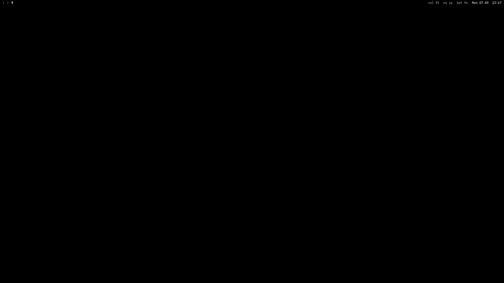
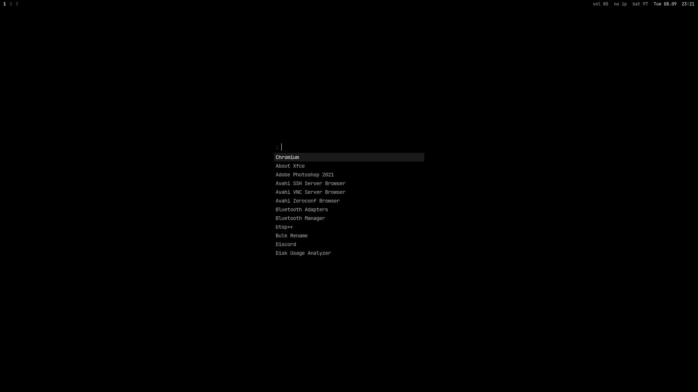
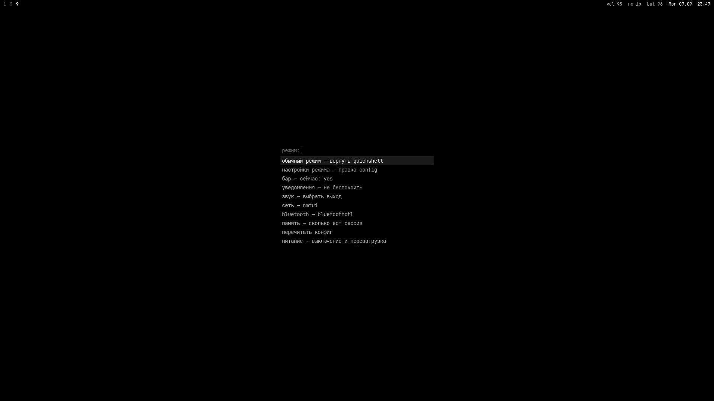
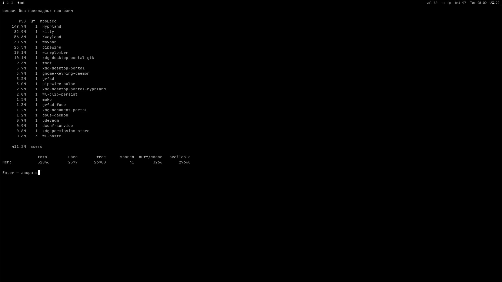

# Руководство

<sub>[README](../README.md) · [English](GUIDE.md) · Русский · [Что нового](UPDATE.md) · [Заметки для десктопа](DESKTOP.md)</sub>

<div align="center">

|  |  |  |  |
| --- | --- | --- | --- |
| **дистрибутив** | Arch · Artix (OpenRC) | **шелл** | Quickshell 0.3 |
| **оконный менеджер** | Hyprland 0.56 | **цвета** | matugen, из обоев |
| **терминал** | kitty | **файлы** | yazi, превью настоящими пикселями |
| **редактор** | Zed | **звук** | PipeWire + filter-chain эквалайзер |
| **шрифты** | JetBrains Mono · Adwaita Sans | **приглашение** | zsh + starship |

</div>

<br>

## Что это

Полная конфигурация рабочего окружения на [Hyprland](https://hypr.land): оконный менеджер, панель,
лаунчер, история буфера обмена, уведомления, экранные индикаторы, экран блокировки, терминал,
файловый менеджер и оболочка. Все цвета в системе выводятся из текущих обоев через
[matugen](https://github.com/InioX/matugen) (Material You), поэтому оформление всегда совпадает с
тем, что на экране.

Оболочка целиком на Quickshell: панель, лаунчер, буфер обмена, уведомления, индикаторы
громкости и яркости, выбор обоев, обзор окон и меню выключения — всё один процесс.

За ним следит watchdog: упавший Quickshell перезапускается, а после трёх падений подряд попытки
прекращаются и приходит уведомление — вместо бесконечного мигания панели. `shell-switch status`
показывает состояние, `shell-switch restart` перезапускает.

## С чистого диска

Полный путь от пустого диска до этого рабочего стола. Если Arch или Artix уже стоит, сразу
переходите к [Установке](#установка). Команды с пометкой **Arch** или **Artix** у двух систем
разные, всё остальное одинаково.

<details>
<summary><b>1. Загрузка установщика</b> — <sub>ISO, флешка, настройки прошивки</sub></summary>


* **Arch** — ISO с [archlinux.org/download](https://archlinux.org/download/).
* **Artix** — ISO **base OpenRC** с [artixlinux.org/download](https://artixlinux.org/download.php).

Запишите образ на флешку (всё на ней сотрётся):

```bash
sudo dd if=archlinux-x86_64.iso of=/dev/sdX bs=4M status=progress oflag=sync
```

В Windows — [Rufus](https://rufus.ie) в режиме DD или флешка с [Ventoy](https://www.ventoy.net).

В прошивке (обычно `F2`, `F10`, `Del` или `Esc` при включении): режим загрузки **UEFI**,
**Secure Boot выключить**, на ноутбуках с NVIDIA режим видеокарты — *Hybrid* / *MSHybrid*, а не
*iGPU only*. Загрузитесь с флешки.

Убедитесь, что система загрузилась именно в UEFI — команда должна вывести число, а не ошибку:

```bash
cat /sys/firmware/efi/fw_platform_size
```

</details>

<details>
<summary><b>2. Сеть, раскладка, часы</b></summary>


Проводной интернет работает сам. Для Wi-Fi:

**Arch**

```bash
iwctl
[iwd]# device list
[iwd]# station wlan0 scan
[iwd]# station wlan0 get-networks
[iwd]# station wlan0 connect "ИмяСети"
[iwd]# exit
```

**Artix** (логин `root`, пароль `artix`)

```bash
rfkill unblock wifi
connmanctl
connmanctl> enable wifi
connmanctl> scan wifi
connmanctl> services
connmanctl> agent on
connmanctl> connect wifi_xxxxxxxx_managed_psk
connmanctl> quit
```

Проверка и синхронизация времени:

```bash
ping -c 3 archlinux.org
timedatectl set-ntp true        # только Arch; в Artix время синхронизируется уже в установленной системе
```

</details>

<details>
<summary><b>3. Разметка и форматирование</b> — <sub>EFI + корень, ext4 или btrfs</sub></summary>


Найдите диск (`nvme0n1`, `sda`, …):

```bash
lsblk
```

> ⚠️ Следующий шаг **стирает весь диск**. Проверьте имя дважды.

```bash
cfdisk /dev/nvme0n1
```

Выберите `gpt` и создайте два раздела:

| Раздел | Размер | Тип |
| --- | --- | --- |
| `/dev/nvme0n1p1` | 1G | EFI System |
| `/dev/nvme0n1p2` | всё остальное | Linux filesystem |

Форматирование и монтирование (на SATA-диске имена `sda1`, `sda2`):

```bash
mkfs.fat -F 32 /dev/nvme0n1p1
mkfs.ext4 /dev/nvme0n1p2

mount /dev/nvme0n1p2 /mnt
mount --mkdir /dev/nvme0n1p1 /mnt/boot
```

Swap не обязателен — потом можно добавить swap-файл или zram (`zram-generator` в Arch, `zramen` в Artix).

</details>

<details>
<summary><b>4. Базовая система</b> — <sub>микрокод под ваш процессор</sub></summary>


Пакет микрокода зависит от **процессора**:

| Процессор | Пакет |
| --- | --- |
| Intel | `intel-ucode` |
| AMD | `amd-ucode` |

**Arch**

```bash
pacstrap -K /mnt base base-devel linux linux-headers linux-firmware \
    intel-ucode networkmanager sudo git nano
genfstab -U /mnt >> /mnt/etc/fstab
arch-chroot /mnt
```

**Artix**

```bash
basestrap /mnt base base-devel openrc elogind-openrc linux linux-headers linux-firmware \
    intel-ucode networkmanager networkmanager-openrc sudo git nano
fstabgen -U /mnt >> /mnt/etc/fstab
artix-chroot /mnt
```

На процессоре AMD замените `intel-ucode` на `amd-ucode`.

</details>

<details>
<summary><b>5. Настройка системы</b> — <sub>часовой пояс, локаль, пользователь, загрузчик</sub></summary>


Всё дальше выполняется внутри chroot. `Europe/Kyiv`, `myhost` и `user` замените на свои.

```bash
ln -sf /usr/share/zoneinfo/Europe/Kyiv /etc/localtime
hwclock --systohc

sed -i 's/^#en_US.UTF-8/en_US.UTF-8/; s/^#ru_RU.UTF-8/ru_RU.UTF-8/' /etc/locale.gen
locale-gen
echo 'LANG=en_US.UTF-8' > /etc/locale.conf

echo myhost > /etc/hostname
```

В **Artix** имя хоста нужно ещё и OpenRC:

```bash
echo 'hostname="myhost"' > /etc/conf.d/hostname
```

Пароль root, ваш пользователь и `sudo` для группы `wheel`:

```bash
passwd
useradd -m -G wheel,video,audio,input -s /bin/bash user
passwd user
EDITOR=nano visudo        # раскомментируйте строку:  %wheel ALL=(ALL:ALL) ALL
```

Загрузчик (микрокод GRUB подхватит сам):

```bash
pacman -S grub efibootmgr
grub-install --target=x86_64-efi --efi-directory=/boot --bootloader-id=GRUB
grub-mkconfig -o /boot/grub/grub.cfg
```

Сеть в установленной системе:

```bash
systemctl enable NetworkManager          # Arch
rc-update add NetworkManager default     # Artix
```

Выход и перезагрузка (флешку вынуть):

```bash
exit
umount -R /mnt
reboot
```

Войдите под своим пользователем. Wi-Fi теперь — через `nmtui`.

</details>

<details>
<summary><b>6. Artix: репозитории Arch</b> — <sub>только для Artix, нужны для Hyprland и Quickshell</sub></summary>


Hyprland, Quickshell и часть зависимостей лежат в `[extra]` у Arch. У Artix для этого есть
официальный мост:

```bash
sudo pacman -S artix-archlinux-support
sudo pacman-key --populate archlinux
```

Допишите в **конец** `/etc/pacman.conf` (после репозиториев Artix):

```ini
[extra]
Include = /etc/pacman.d/mirrorlist-arch

[multilib]
Include = /etc/pacman.d/mirrorlist-arch
```

Там же раскомментируйте `[lib32]` и обновитесь:

```bash
sudo pacman -Syu
```

Если `[extra]` не подключён, установщик остановится и скажет об этом.

</details>

<details>
<summary><b>7. Драйверы видеокарты</b> — <sub>NVIDIA, AMD, Intel, гибридные ноутбуки</sub></summary>


Не знаете, что стоит внутри?

```bash
lspci -k | grep -EA3 'VGA|3D|Display'
```

Включите `[multilib]` (Arch: раскомментировать в `/etc/pacman.conf`; Artix: сделано в шаге 6),
чтобы были 32-битные библиотеки для Steam и Wine, затем `sudo pacman -Syu`.

**AMD Radeon**

```bash
sudo pacman -S mesa lib32-mesa vulkan-radeon lib32-vulkan-radeon
```

Аппаратное декодирование видео (VA-API) встроено в `mesa`. Больше ничего не нужно — драйвер ядра
`amdgpu` загружается сам.

**Intel**

```bash
sudo pacman -S mesa lib32-mesa vulkan-intel lib32-vulkan-intel intel-media-driver
```

`intel-media-driver` — для Broadwell (5-е поколение) и новее; для старых чипов вместо него
`libva-intel-driver`.

**NVIDIA**

Пакет выбирается по поколению карты:

| Карта | Пакет |
| --- | --- |
| RTX 50/40/30/20, GTX 16xx (Turing и новее) | `nvidia-open` (`nvidia-open-dkms` для `linux-lts`, `linux-zen` и других ядер) |
| GTX 10xx, GTX 9xx (Pascal, Maxwell) | `nvidia-580xx-dkms` + `nvidia-580xx-utils` из AUR (вместо строки ниже) |
| старше | Hyprland не поддерживает — используйте встроенную графику или `nouveau` |

```bash
sudo pacman -S nvidia-open nvidia-utils lib32-nvidia-utils egl-wayland libva-nvidia-driver
```

Ранняя загрузка драйвера, чтобы Hyprland получил видеокарту с первого кадра. В
`/etc/mkinitcpio.conf`:

```bash
MODULES=(nvidia nvidia_modeset nvidia_uvm nvidia_drm)
```

и уберите `kms` из строки `HOOKS=(...)`, затем пересоберите и перезагрузитесь:

```bash
sudo mkinitcpio -P
sudo reboot
```

Проверьте, что DRM modesetting включён — должно вывести `Y`:

```bash
cat /sys/module/nvidia_drm/parameters/modeset
```

Если выводит `N`, добавьте `nvidia_drm.modeset=1` в `GRUB_CMDLINE_LINUX_DEFAULT` в
`/etc/default/grub` и выполните `sudo grub-mkconfig -o /boot/grub/grub.cfg`.

**Гибридные ноутбуки (Intel/AMD + NVIDIA)** — ставьте драйверы для **обеих** видеокарт. Рабочий
стол работает на встроенной, а NVIDIA просыпается для игр (`prime-run <игра>` из пакета
`nvidia-prime`).

Руками потом ничего править не нужно: установщик смотрит в `lspci`, оставляет переменные NVIDIA в
`~/.config/hypr/config/env.conf` только если карта NVIDIA есть, а на AMD и Intel переключает
VA-API на `radeonsi` или `iHD`.

</details>

<details>
<summary><b>8. Процессор</b> — <sub>энергосбережение Intel и AMD</sub></summary>


Микрокод поставлен в шаге 4. Проверьте, что он загрузился:

```bash
journalctl -k | grep -i microcode       # Arch
dmesg | grep -i microcode               # Artix
```

* **AMD** (Zen 2 и новее) на свежих ядрах сам использует драйвер `amd-pstate` —
  `cat /sys/devices/system/cpu/cpu0/cpufreq/scaling_driver` выводит `amd-pstate-epp`.
* **Intel** использует `intel_pstate`, тоже автоматически.

На ноутбуке поставьте демон профилей питания, чтобы остров мог их переключать:

```bash
sudo pacman -S power-profiles-daemon
sudo systemctl enable --now power-profiles-daemon          # Arch
sudo pacman -S power-profiles-daemon-openrc && \
    sudo rc-update add power-profiles-daemon default       # Artix
```

</details>

<details>
<summary><b>9. Установка конфигурации</b></summary>


От обычного пользователя (не root), с работающей сетью:

```bash
bash <(curl -fsSL https://raw.githubusercontent.com/fedyaqq34356/rosa/main/install.sh)
```

Установщик сам определяет Arch или Artix и видеокарту, ставит все пакеты (и `yay` для AUR, если
AUR-помощника ещё нет), включает NetworkManager и Bluetooth под systemd или OpenRC, раскладывает
файлы, делает zsh оболочкой входа и собирает цветовую схему.

Положите несколько картинок в `~/Pictures/Wallpapers`, перелогиньтесь в TTY и запустите сессию:

```bash
start-hyprland
```

Чтобы она запускалась сама после входа на tty1, допишите в конец `~/.zprofile`:

```bash
[[ -z $WAYLAND_DISPLAY && $(tty) == /dev/tty1 ]] && exec start-hyprland
```

Первые шаги: `Super` + `W` — выбрать обои, `Super` + `D` — запуск приложений, `Super` + `Shift` +
`I` — настройка острова. Все сочетания — в разделе [Горячие клавиши](#горячие-клавиши).

</details>

## Установка

Одна команда: скачивает репозиторий, ставит все зависимости, делает резервную копию текущих
конфигов и генерирует цветовую схему.

```bash
bash <(curl -fsSL https://raw.githubusercontent.com/fedyaqq34356/rosa/main/install.sh)
```

Или из клона:

```bash
git clone https://github.com/fedyaqq34356/rosa.git
cd rosa
./install.sh
```

| Флаг | Действие |
| --- | --- |
| `--dry-run` | показать все шаги, ничего не менять |
| `--no-packages` | только разложить конфиги, пакеты не ставить |
| `--games` / `--no-games` | Steam, gamemode и MangoHud (на десктопе включено по умолчанию) |
| `--printer` / `--no-printer` | Canon LBP6000 через CUPS + CAPT (включается, если принтер подключён) |
| `--pulse-elite` / `--no-pulse-elite` | профиль гарнитуры PlayStation Pulse Elite автора (выключен, если она не сопряжена) |
| `--update` | подтянуть свежую версию и обновить установленное |
| `-y`, `--yes` | не спрашивать подтверждения |

Установщику нужен `pacman`, запускать нужно от обычного пользователя (не от root). Предыдущая
конфигурация сохраняется в `~/.config/dotfiles-backup-<время>`.

Поддерживаются обе системы инициализации: на Arch с systemd службы включаются через `systemctl`, а zram
даёт `zram-generator`; на Artix ставятся скрипты OpenRC.

### Удаление

```bash
bash ~/.local/share/rosa/uninstall.sh      # или ./uninstall.sh из своего клона
```

Всё, что положил установщик, переносится в `~/.config/rosa-removed-<время>`, а конфигурация,
которая была до первой установки, возвращается из бэкапа. `--system` убирает и системные части
(правила sudoers, zram, drop-in amdgpu для initramfs), `--dry-run` показывает план. Пакеты остаются.

<details>
<summary><b>Структура</b> — <sub>что где лежит</sub></summary>

| Путь | Что там |
| --- | --- |
| `config/hypr/hyprland.lua` | точка входа на Hyprland 0.55+; грузит `config/hypr/cfg/` — окна двигаются на настоящих пружинах |
| `config/hypr/cfg/` | Lua-конфиг: `animations`, `binds`, `rules`, `look`, `startup`, `env`, чёрный режим |
| `config/hypr/hyprland.conf` | точка входа hyprlang для Hyprland старше 0.55; установщик выбирает сам |
| `config/hypr/config/` | файлы hyprlang по теме на файл; Lua-конфиг тоже читает отсюда `env`, `monitors`, `colors`, `shape` и ссылку режима |
| `config/hypr/scripts/audio/` | громкость, удержание уровня микрофона, запуск WirePlumber |
| `config/hypr/scripts/capture/` | скриншоты, запись экрана, апскейл картинок |
| `config/hypr/scripts/clipboard/` | история, сторож, очистка, превью на острове |
| `config/hypr/scripts/lock/` | экран блокировки, его строки статуса и сторож простоя |
| `config/hypr/scripts/notify/` | счётчик пропущенных уведомлений, тест и трассировка D-Bus |
| `config/hypr/scripts/print/` | бэкенд панели печати; в `print/print-root/` — файлы для root |
| `config/hypr/scripts/system/` | чистка кэша, обновления, фикс монитора, sysmon, фокус, меню питания |
| `config/hypr/scripts/theme/` | генераторы палитры для браузеров, курсора, Kvantum, LibreOffice, иконок, звуков |
| `config/hypr/scripts/tools/` | калькулятор, списки файлов, сортировка загрузок, git-активность |
| `config/hypr/scripts/wallpaper/` | установка, ротация, индекс и выбор обоев |
| `config/quickshell/f/` | шелл: `bar`, `panels`, `overlays`, `desk`, `services`, `design`, `reusables`, `lang` |
| `config/matugen/` | шаблоны, в которые рендерится палитра |
| `bin/` | команды, которые ложатся в `~/.local/bin` |
| `src/islandd/` | помощник на Rust, установщик собирает его в `~/.local/bin/islandd`: нагрузка системы, батарея мыши, загрузки, VPN и исходящие соединения для шелла, плюс сортировка загрузок, без запуска команд по таймеру |
| `home/` | дотфайлы, которые ложатся в `~` |
| `extras/` | необязательное, установщик это не раскладывает |

Состояние машины в конфиге не живёт: уровень микрофона и выбор локскрина лежат в
`~/.local/state/hypr/`. Обновление само переносит их туда и убирает старые плоские копии скриптов.

</details>

<details>
<summary><b>Обновление</b> — <sub>одна команда и что она не тронет</sub></summary>


Если конфигурация уже стоит, установщик заново гонять не нужно — есть отдельный режим обновления,
который не трогает систему и подтягивает только конфиги:

```bash
dots-update
```

**Или просто нажмите кнопку.** Шелл раз в 30 минут проверяет GitHub. Когда выходит новая
версия, рядом с рабочими столами появляется кнопка **обновление** с размером — или в левом верхнем
углу, если бар отдан острову. По нажатию открывается терминал со списком изменений, числом файлов и
весом обновления и вопросом `Обновить сейчас? [y/N]`. Откажетесь — терминал закроется, кнопка
останется; согласитесь — обновление пройдёт само, и кнопка исчезнет до следующей версии.

Он забирает свежую ревизию, показывает список коммитов, которые приедут, раскладывает файлы (всё
заменяемое сначала уходит в резервную копию), доставляет только реально отсутствующие пакеты —
полного обновления системы не делает, — пересобирает палитру по текущим обоям и перезапускает
Hyprland с панелью на месте. Перелогиниваться не надо.

Из клона то же самое:

```bash
cd rosa && ./install.sh --update
```

`--dry-run` работает и здесь: покажет каждый шаг, ничего не меняя.

</details>

<details>
<summary><b>Оформление</b> — <sub>как обои становятся палитрой и куда уходит каждый шаблон</sub></summary>


```
обои ──▶ matugen ──┬──▶ hyprland   рамки окон
                   ├──▶ hyprlock   экран блокировки
                   ├──▶ quickshell панель, лаунчер, индикаторы
                   ├──▶ kitty      палитра терминала
                   ├──▶ rofi       лаунчер
                   ├──▶ dunst      уведомления
                   ├──▶ gtk 3/4    Thunar и остальные GTK-приложения
                   ├──▶ papirus    иконки папок в тон акценту
                   ├──▶ wlogout    меню выключения
                   ├──▶ sddm       экран входа
                   └──▶ cava       визуализатор звука
```

Единая точка входа — `~/.config/hypr/scripts/wallpaper/set-wallpaper.sh`: он красит все подключённые
мониторы, сохраняет выбор в `~/.config/hypr/current-wallpaper` и перезапускает matugen. Шаблоны
лежат в `~/.config/matugen/templates` — добавьте туда файл и один блок в
`~/.config/matugen/config.toml`, и в общую схему войдёт любое другое приложение.

Экран блокировки берёт те же обои. `Super+Shift+L` запускает обёртку, которая пересобирает палитру,
если обои сменились с прошлого раза, — на локскрине всегда те обои, что стоят на рабочем столе:
размытые и притемнённые, поверх них аватар, часы рукописными штрихами и дата над полем пароля.

Поле — это поле: пилюля с замком, по точке на набранный символ, кнопка отправки, которая на время
раздумий PAM превращается в кольцо ожидания, и раскладка с предупреждением о Caps Lock под ней.
Неверный пароль не трясёт поле, а растворяет и возвращает, объясняя, что не так. То, что играет,
стоит в одном углу, пропущенные уведомления — в другом.

</details>

<details>
<summary><b>Аппаратное декодирование видео</b> — <sub>NVIDIA, VA-API и флаги браузера, которые правда важны</sub></summary>


Сессия уже экспортирует `LIBVA_DRIVER_NAME=nvidia` и `NVD_BACKEND=direct`, но этого мало: нужен
`libva-nvidia-driver`, который связывает VA-API с NVDEC, и каждому браузеру надо отдельно сказать
им пользоваться.

Chromium принимает флаги только в командной строке — бинарник не обёртка, редактировать
`chromium-flags.conf` нечего; скопируй ярлык в `~/.local/share/applications/` и допиши:

```
--ozone-platform-hint=auto --enable-features=VaapiVideoDecodeLinuxGL,VaapiIgnoreDriverChecks,AcceleratedVideoDecodeLinuxGL --ignore-gpu-blocklist --enable-gpu-rasterization --enable-zero-copy --use-gl=angle --use-angle=gl
```

Firefox и LibreWolf читают `user.js` в активном профиле:

```js
user_pref("media.ffmpeg.vaapi.enabled", true);
user_pref("media.hardware-video-decoding.force-enabled", true);
user_pref("widget.dmabuf.force-enabled", true);
user_pref("gfx.webrender.all", true);
user_pref("media.av1.enabled", false);
```

и переменную `MOZ_DISABLE_RDD_SANDBOX=1`, иначе процесс декодера не достучится до драйвера. AV1
выключен намеренно: у Pascal и более старых карт аппаратного декодера AV1 нет, и такие потоки
тихо уезжают обратно на процессор.

Проверять в `chrome://gpu` и `about:support` или через `nvidia-smi dmon` во время
воспроизведения — колонка `dec` остаётся нулевой, пока декодирование идёт на процессоре.

</details>

<details>
<summary><b>Простой</b> — <sub>таймеры в шелле, решение — в одном скрипте</sub></summary>


Шелл блокирует сессию через 50 минут без ввода и гасит панели ещё через пять. Оба таймера лежат в
настройках самого шелла, а не в третьем конфиге со своим синтаксисом, но решение «стоит ли» осталось
за `config/hypr/scripts/lock/idle-guard.sh`: он не даёт сработать, пока окно развёрнуто на весь экран,
пока реально играет звук (поток откупорен, а не просто держит устройство), пока идёт запись и пока
жив любой процесс из `~/.config/hypr/idle-inhibit.list`.

Это сделано намеренно: скрипт уже знает все причины не блокировать, а второе мнение, написанное на
QML, только спорило бы с ним.

Список сверяется с именами процессов через `pgrep -x`, по одному в строке. В репозитории лежит
только `idle-inhibit.list.example` — скопируйте и допишите своё, рабочая копия из репозитория
исключена.

`hypridle` больше не запускается; строка оставлена закомментированной в
`config/hypr/config/startup.conf`.

</details>

<details>
<summary><b>Меню выключения</b> — <sub>почему это панель, а не скрипт</sub></summary>


`Super`+`P` открывает экран Quickshell: пять круглых кнопок в ряд — заблокировать, сон, выйти,
перезагрузка, выключение — и одна светящаяся линза, которая плавно перетекает под выбранную. При
выборе линза расходится на весь экран и гаснет в фон, и только потом уходит команда. `l`, `s`, `e`,
`r` и `p` срабатывают сразу; стрелки двигают выбор, `Enter` подтверждает, `Escape` или клик мимо
закрывают. Прежнее меню с плитками осталось на `quickshell:powerMenuClassic`.

Цвета берутся из обоев, как и везде. `wlogout` по-прежнему красится из той же палитры и остаётся
отдельным меню выключения.

</details>

<details>
<summary><b>Экран входа</b> — <sub>SDDM на обоях рабочего стола</sub></summary>


`extras/sddm` — тема SDDM в том же стиле: текущие обои под мягким размытием, палитра matugen,
крупные часы, аватар из `~/.face` и одно стеклянное поле пароля. После входа размытие уходит, и
экран передаёт управление ровно тем обоям, на которых открывается рабочий стол.

```sh
sudo extras/sddm/install.sh      # скопировать тему и выбрать её
sudo extras/sddm/uninstall.sh    # убрать
```

Обои, палитра и аватар лежат в `/var/lib/f-sddm`, каталог принадлежит пользователю.
`set-wallpaper.sh` обновляет их через `sddm-sync.sh` при каждой смене обоев, так что экран входа
следует за рабочим столом без sudo.

</details>

<details>
<summary><b>Скриншоты</b> — <sub>область, окно, монитор, пипетка, распознавание текста</sub></summary>


`config/hypr/scripts/capture/screenshot.sh` принимает один аргумент и закрывает все случаи:

| Режим | Что снимает |
| --- | --- |
| `region` | область, выделенную мышью |
| `window` | одно окно ровно по его границам |
| `output` | монитор под курсором |
| `all` | все подключённые мониторы одним снимком |
| `edit` | область, затем [satty](https://github.com/gabm/Satty) — стрелки, размытие, текст |
| `color` | цвет под курсором, hex в буфер обмена |
| `ocr` | область, её текст распознаётся и уходит в буфер — картинка не сохраняется |

Пока идёт выделение, экран заморожен через `hyprpicker -r -z` — меню и анимации не убегают. Каждый
снимок попадает в `~/Pictures/Screenshots` **и** в буфер обмена, а уведомление показывает его же
миниатюрой. Другая папка задаётся переменной `SCREENSHOT_DIR`.

</details>

<details>
<summary><b>Запись экрана</b> — <sub>монитор или область, со звуком системы</sub></summary>


`config/hypr/scripts/capture/record-toggle.sh` работает переключателем: первый вызов запускает, второй
останавливает — в каком бы режиме запись ни началась.

| Аргумент | Что делает |
| --- | --- |
| `screen` | монитор под курсором (по умолчанию) |
| `region` | область, выделенная мышью |
| `--mic` | писать микрофон вместо звука системы |
| `--no-audio` | только видео |

По умолчанию пишется звук системы — через monitor-источник текущего вывода, то есть в записи будет
то, что было слышно. Файлы уходят в `~/Videos` (меняется переменной `RECORD_DIR`), путь готового
файла попадает в буфер обмена.

Пока идёт запись, в панели мигает красная точка с таймером — клик по ней останавливает запись.

</details>

<details open>
<summary><b>Динамический остров</b> — <sub>одна пилюля вместо часов, которая превращается в то, что происходит</sub></summary>


Остров стоит посередине бара, на месте часов, и по умолчанию бар отдаёт ему всю строку: зоны
расступаются, место остаётся зарезервированным. В покое это узкая пилюля с часами или с точками
рабочих столов, когда больше ничего не происходит, — номер стола живёт внутри активной точки.

Всё остальное вырастает из этой пилюли. Ширина и высота идут пружиной, новое содержимое приезжает
снизу, пока старое уезжает вверх, а на любое событие остров сначала слегка подскакивает — тело
отзывается раньше формы.

**Что он показывает**, от важного к второстепенному: звонящий будильник → запись экрана →
громкость и яркость → новое уведомление → идущий таймер → музыка → часы. Каждый источник
выключается отдельно.

- **Музыка** — обложка с радиальным спектром встаёт в правый угол, часы остаются в середине.
  Наведите курсор — остров раскрывается в карточку плеера: название, исполнитель, полоса
  перемотки, назад / пауза / вперёд. Волна и свечение кромки берут цвет обложки.
- **Уведомления** разворачиваются в карточку со значком приложения, отправителем и двумя строками
  текста и сворачиваются обратно. Пока их показывает остров, обычная всплывашка не рисуется второй раз.
- **Таймеры** уходят в левый кружок рядом с пилюлей — кольцо заполняется, последняя минута идёт
  цифрами. Когда время вышло, остров раскрывается красным с кнопками «отложить» и «выключить».
  Пока печатает принтер, тот же кружок занимает очередь печати.
- **Громкость, яркость, раскладка, рабочий стол** — одна строка, которая подменяет середину на
  мгновение и уходит.
- **Наушники, зарядка, севшая батарея, разряженная мышь или клавиатура, Wi-Fi и VPN** — у каждого
  своя маленькая сцена: кольцо заряда, наполняющаяся батарейка, веер, который ловит сеть.

Смахните раскрытый остров вверх — он закроется, и наведение не откроет его снова, пока курсор не уйдёт.

`Super` + `Shift` + `I` открывает его настройки: форма (нет / пилюля / карточка), внутри бара или
отдельно, верхняя или нижняя кромка, выравнивание, монитор, смещения, размеры обеих форм, заливка,
цвет по событию, сколько событие держится и сколько остров ждёт перед раскрытием. Всё применяется сразу.

Посмотреть все сцены без железа: `qs -c f ipc call island play bt` (а ещё `btoff`, `power`, `low`,
`peri`, `net`, `vpn`, `notif`, `osd`); `qs -c f ipc call island pin true` держит остров раскрытым.

</details>

<details>
<summary><b>Панель</b> — <sub>что такое каждый островок и зачем он там</sub></summary>


Слева рабочие столы, по центру часы, справа три группы, разделённые волосяными линиями: индикатор
записи и трей; Wi-Fi, микрофон и громкость; раскладка и батарея. Контраст расставлен по частоте
обращения: батарея и раскладка держат его на себе, значки приглушены до 75% прозрачности, цвет
берут только проблемные состояния — отвалившийся Wi-Fi или выключенный микрофон.

Иконки папок тоже. Papirus содержит по набору папок на каждый цвет, а
`config/hypr/scripts/theme/papirus-tint.py` выбирает ближайший к текущему акценту в пространстве CIE Lab
и собирает маленькую пользовательскую тему иконок: она наследует Papirus-Dark и подменяет только
папки — без root и без записи в `/usr/share`. Запускается хуком matugen, поэтому новые обои
перекрашивают папки вместе со всем остальным.

Рядом с рабочими столами живёт плеер: обложка и спектр, который рисует второй экземпляр `cava`,
читающий сырые уровни с pipewire. Название трека вынесено в подсказку и в панель, а не бежит
строкой по бару. Клик по обложке ставит паузу, клик по островку открывает панель плеера, колесо
переключает треки. `cava` запускается только пока что-то играет.

Наведение на любой элемент бара поднимает подсказку под полосой: окно бара выше самой полосы, а
область ввода обрезана по ней, поэтому пустое место пропускает клики к окнам под баром. Клик по
часам открывает календарь.

Периферия со своей батареей — мышь, клавиатура, гарнитура — показывается только когда заряд падает
ниже 40%: постоянный значок «мышь заряжена» это шум. Пока открыт лаунчер, точки рабочих столов, где
уже запущено подсвеченное приложение, загораются — вторая копия не заводится по недосмотру.

Клик по значку Wi-Fi (или `Super`+`N`) открывает панель сетей, `Super`+`B` — её же на вкладке
Bluetooth. Вид общий: то, к чему подключён, горит в центре, остальное вращается вокруг по двум
наклонённым кольцам — чем сильнее сигнал, тем ближе к центру и тем быстрее орбита. Наведение
останавливает вращение и печатает подробности под графом: в чип шириной 96 пикселей не влезают ни
скорость канала, ни MAC. Клик подключает, защищённая сеть открывает поле пароля, клик по активной
отключает.

Радиусы колец, размер чипа и наклон — не вопрос вкуса: сочетание проверено полным перебором, и при
любом взаимном повороте колец два чипа не могут наложиться. Всё, что не поместилось в восемь
орбитальных мест, доступно в списочном режиме, а в подвале написано, сколько осталось за кадром.
Wi-Fi работает через `nmcli` и обновляется по событиям `nmcli monitor`, Bluetooth разговаривает с
BlueZ по D-Bus, поэтому заряд наушников и состояние сопряжения приходят по факту изменения, а не по
опросу. Индикатор раскладки (`EN` / `RU` / `UA` …) следует за `Alt`+`Shift`, по нему же можно
кликнуть, чтобы переключить раскладку. По умолчанию стоит `us,ru`; чтобы поменять, запиши
`kb_layout = us,ru,ua` (при необходимости ещё `kb_variant` и `kb_options`) в
`~/.config/hypr/config/keyboard.conf`. Обновления этот файл не трогают.

`Super`+`Shift`+`M` открывает панель звука на том же орбитальном виде: текущий выход в центре,
громкость нарисована дугой вокруг него, остальные устройства кружат рядом. Клик делает устройство
основным, колесо над ним меняет громкость именно этого устройства, над ядром — текущего. `Tab`
переключает выход и вход, `+`/`-` меняют уровень, `M` заглушает, `Escape` закрывает.

Громкость, микрофон и яркость показывают одну и ту же карточку внизу активного экрана. Уровень
нарисован бегущей волной, а не полоской. Пока что-то играет, спектр из `cava` управляет местной
амплитудой волны — она вздувается там, где громче. Плеер иногда рапортует «играет», когда поток
на самом деле остановлен: тогда во всех полосах нули, и волна плавно возвращается к обычной
синусоиде, а не схлопывается в прямую. Мьют не прячет индикатор, а распрямляет его. Яркость идёт
через `brightnessctl -c backlight`; если устройства подсветки в системе нет, индикатор так и
скажет, вместо того чтобы клавиши молча ничего не делали.

У часов нет цифр секунд — на таком размере они суетливы. Вместо них обводка обходит контур самого
островка за минуту: движение есть, мельтешения нет. При переключении рабочего стола между старой и
новой точкой протягивается полоска, которая втягивается в точку назначения, поэтому взгляд следует
за переходом, а не ищет активную точку заново. Обложка трека сидит внутри тонкой дуги прогресса —
позиция читается, не отнимая ширины под полосу или цифры. Рядом со значком сети появляется точка
VPN, но только пока туннель поднят: определение локальное и дешёвое, а внешний адрес запрашивается
при смене состояния туннеля или по клику, не по таймеру. При старте сессии островки падают сверху
со сдвигом слева направо — бар собирается, а не возникает целиком.

</details>

<details>
<summary><b>Виджеты</b> — <sub>кольца системы, тепловая карта коммитов, уведомления, фокус-режим</sub></summary>


**Кольца системы** — `Super`+`F1` открывает шесть тонких дуг: CPU, RAM, температура, GPU, VRAM и
температура GPU. Цвет дуги идёт от акцента к красному по мере нагрузки, по её концу едет точка. Вся
панель живёт внутри неактивного загрузчика: пока она закрыта, нет ни окна, ни канвы, ни таймера, ни
процесса опроса. Виджет, на который смотрят пару раз в день, не дёргает `nvidia-smi` круглые сутки.
Железо, которого в машине нет, показывает `n/a`, а не выдуманный ноль.

**Процессы** — `Ctrl` + `Shift` + `Esc` выливает из острова одну карточку: самое тяжёлое
приложение, его CPU, память и время работы, а под ними течёт график CPU. Стрелки, колесо или ввод
имени переключают на другое приложение; удержание `Enter` (или иконки) закрывает его. Сначала
приложение просят выйти, и только если через три секунды оно ещё живо — убивают. Процессы собраны
по приложениям, показываются только твои, а сама сессия — Hyprland, шелл, PipeWire, порталы — под
замком. Клик по орбу CPU на `Super` + `F1` открывает панель сразу на том, кто сейчас грузит процессор.

**Тепловая карта в календаре** — ячейки дней залиты по числу коммитов за этот день во всех git-репозиториях
внутри `$HOME`. `git-activity.py` считает их в JSON-кэш раз в час, календарь только читает его и
никогда не ждёт обхода файловой системы. Шкала корневая, а не линейная: один коммит должен быть
заметен, а разница между двадцатью и тридцатью — нет.

**Уведомления** — карточки выезжают справа и уходят туда же. Остаток времени рисуется обводкой,
которая отступает по контуру самой карточки, поэтому отсчёт стал частью формы, а не отдельной
полосой. Наведение ставит его на паузу. Критические держат статичную рамку и ждут клика. Каждая
карточка играет сгенерированный звук: `gen-notify-sounds.py` синтезирует мягкий удар по бруску для
обычных, ниже и с падением для критических, и сухой стук на упор громкости. Ничего не лежит готовым
бинарником — правь таблицы нот и перезапускай скрипт.

**Фокус-режим** — `Super`+`Ctrl`+`F` уводит в тень всё, кроме активного окна: неактивные сильно
затемняются, блюр теряет проход, градиент рамки замирает. Обратное переключение возвращает значения
поимённо, а не перечитывает весь конфиг, поэтому несохранённые эксперименты переживают его.

</details>

<details>
<summary><b>Палитра в рантайме</b> — <sub>почему палитра больше не QML-файл</sub></summary>


Раньше matugen генерировал `Colors.qml` напрямую. Запись QML-файла заставляла Quickshell перечитать
весь конфиг при каждой смене обоев: все объекты пересоздавались, и цвета могли меняться только
скачком. Теперь палитра ложится в `~/.cache/matugen/colors.json`, вне каталога конфига, а
`Colors.qml` — написанный руками синглтон, который следит за этим файлом и переливает каждый цвет в
новый примерно за две трети секунды. Акценты немного отстают от поверхностей, и это читается как
пересборка схемы, а не как наложенный поверх всего фильтр.

Курсор тоже следует за обоями. `gen-cursor-theme.py` читает палитру, рисует двенадцать фигур в SVG и
собирает их в тему hyprcursor через `hyprcursor-util`. У каждой фигуры жирная обводка цветом фона под
заливкой акцентом, поэтому она читается и на белой странице, и в тёмном терминале. Прописаны X11-алиасы,
так что GTK- и Qt-приложения её подхватывают. Для XWayland нужна та же тема в формате Xcursor,
которую `hyprcursor-util` собирать не умеет.

</details>

<details>
<summary><b>Виджеты на столе</b> — <sub>слой обоев, редактор и виды каждого виджета</sub></summary>


`Super` + `Shift` + `W` поднимает слой обоев в режим правки: появляется сетка, виджеты таскаются
мышью, колесо меняет размер, снизу выезжает палитра. Вне этого режима у слоя пустая маска ввода —
клики, перетаскивания и прокрутка проходят насквозь, виджеты видно и они неосязаемы.

Позиции хранятся долями экрана, а не пикселями, поэтому раскладка, собранная на ноутбучной матрице,
ложится так же на внешнем мониторе. У каждого виджета несколько видов:

| Виджет | Виды |
| --- | --- |
| часы | две цифры друг под другом, строка с датой или рукописные штрихи |
| музыка | конверт с названием и полосой позиции либо сама пластинка, вращающаяся при игре |
| погода | карточка с прогнозом на три дня или только глиф и число |
| система | кольца, подписанные полосы, голые цифры, все шесть счётчиков карточкой, вертикальные шкалы или две колонки |
| визуализатор | полосы, волна, венок, зеркальный ряд или матрица точек |
| экранное время | приложения за сегодня полосами или один итог |
| диски | разделы с полосами заполнения или свободное место цифрами |
| сеть | приём и передача или карточка с сетью и скоростью линка |
| уведомления | последние несколько или число непрочитанных |
| обновления | число или первые шесть имён пакетов |

Когда обложки нет, рисуется пластинка — дорожки, вращающийся блик, пустая бумажная этикетка. Для
радио и потоков «без обложки» это норма, а одинокий значок ноты читается как битая картинка.

Пока стол закрыт окном, слоя не существует вовсе. Окно в раскладке или на весь экран прячет обои
целиком, а невидимый виджет всё равно стоит кадров: визуализатор перекрашивает холст шестьдесят раз
в секунду за чужим окном, и cava гонит для него поток. Плавающие окна не в счёт — ради них стол и
держат открытым.

</details>

<details>
<summary><b>Конструктор бара</b> — <sub>бар как данные, а не как файл</sub></summary>


`Super` + `Shift` + `J` открывает редактор самого бара. Три зоны, в каждой сколько угодно островков,
в островке сколько угодно модулей — переставляются, переезжают между зонами, выключаются,
настраиваются. Раскладка больше не живёт в QML: её пишет конструктор в JSON.

Модулей тридцать три: рабочие столы, музыка, часы, дата, трей, Wi-Fi, Bluetooth, VPN, скорость сети,
громкость, микрофон, батарея, раскладка, яркость, периферия, запись экрана, исходящие соединения,
обновления, уведомления, «не беспокоить», CPU, RAM, GPU, VRAM, обе температуры, диск, погода,
аптайм, таймер, разделитель, отступ, своя надпись и своя команда — последняя крутится по таймеру и
умеет что-то делать по щелчку.

Вторая вкладка — вид: высота бара и плитки, отступы, промежутки, поля, скругление, размер шрифта и
глифов, заливка и заливка под курсором, прозрачность обводки, тень, обводка, анимация появления,
рост под курсором и подсказки. Умолчания повторяют прежний рукописный бар модуль в модуль: кто
открыл конструктор и ничего не тронул, разницы не увидит.

Добавить в шелл новый модуль — это один компонент в `Modules.qml` и одна строка в реестре;
конструктор подхватит его сам, вместе с настройками.

</details>

<details>
<summary><b>Настройки</b> — <sub>одна карточка, по флагу на функцию</sub></summary>


`Super` + `Shift` + `P` открывает одну карточку с переключателями. Каждая необязательная часть шелла
— звуки, виджеты, док, рисование, экранное время, агент прав, простой — это одна строка здесь, один
флаг в `Prefs` и один загрузчик в `shell.qml`. Выключенное не стоит ничего, а удаляется вместе со
своими файлами и одной строкой.

Там же язык интерфейса, край для бара, шрифт заголовков и сигнал уведомлений — каждый с
предпрослушкой или мгновенным применением.

</details>

<details>
<summary><b>Звук интерфейса</b> — <sub>по сэмплу на жест и почему они «выстрелил и забыл»</sub></summary>


У каждого жеста свой звук: клик для кнопок, тяжелее — для действий, которые что-то подтверждают,
разные стингеры на открытие и закрытие панели, храповик под тянущей рукой, подключение и отключение
для радиомодулей. Воспроизведение — «выстрелил и забыл» через `execDetached`, по процессу на сэмпл:
один общий процесс держит только одного ребёнка, и второй звук обрывал бы первый на полуноте.

Громкость и сигнал — в настройках, вся система выключается одним тумблером.

</details>

<details>
<summary><b>Эквалайзер</b> — <sub>биквады PipeWire, кривая и спектр за ней</sub></summary>


`Super` + `Shift` + `Q` — десять полос на штатных биквадах PipeWire: ни EasyEffects, ни наборов
плагинов, ни второго звукового демона. Граф описан в
`config/pipewire/pipewire.conf.d/99-shell-eq.conf` и читается при старте PipeWire, а усиления потом
уходят живьём, по одному вызову `pw-cli` на изменение.

На одной сетке две вещи: кривая, которую задают полосы, и живой спектр за ней, пока что-то играет.
Ползунки говорят, что попросили; спектр — есть ли там что поднимать; кривая поверх показывает, куда
легла рука относительно музыки. Ручки сидят на самой кривой, двойной клик обнуляет полосу.

Пресеты: ровно, низы, верхи, голос, поп, рок, джаз, классика и ночная кривая, поднимающая оба края
для тихого прослушивания.

</details>

<details>
<summary><b>Экранное время</b> — <sub>считает шелл, пауза на локскрине, хранится две недели</sub></summary>


Считает сам шелл, а не фоновый демон: он и так знает, какое окно в фокусе, и отдельный процесс лишь
дублировал бы это, чтобы потом с ним не сойтись. Шаг в 15 секунд достаточно точен для формы дня и
достаточно дёшев, чтобы работать всегда.

Счёт останавливается на локскрине и при погашенном экране. История хранится две недели в
`~/.local/state/quickshell/` и никуда не уходит с машины.

</details>

<details>
<summary><b>Запрос прав</b> — <sub>свой polkit-агент</sub></summary>


Шелл рисует свой polkit-агент. Без него запрос рисует чужой — другой шрифт, другие радиусы, другое
представление о том, как выглядит диалог, — ровно в тот момент, когда у человека спрашивают, доверяет
ли он тому, что на экране. Неверный пароль встряхивает карточку, а не просто печатает красную строку.

</details>

<details>
<summary><b>Файлы</b> — <sub>yazi в kitty, перекрашенный вместе со всем</sub></summary>


`Super` + `E` открывает yazi внутри kitty: превью картинок и видео идут честными пикселями через
графический протокол kitty, а флейвор генерируется matugen вместе со всем остальным — проводник
перекрашивается вслед за обоями. Thunar остался на `Super` + `Shift` + `Y` для перетаскивания файлов
в другие программы, чего терминал не умеет.

</details>

<details>
<summary><b>Языки</b> — <sub>английский и русский, без перезапуска</sub></summary>


Интерфейс на английском и русском, переключается в настройках без перезапуска. Строки лежат в
`config/quickshell/f/lang/*.json`; правило множественного числа принадлежит языку, поэтому английский
отдаёт две формы, русский три. Названия месяцев и дней берутся оттуда же, а не из локали Qt: язык
шелла — отдельная настройка и за `LANG` не следует.

</details>

<details>
<summary><b>Серёжа мод</b> — <sub>чёрная сессия, из которой шелл уходит совсем</sub></summary>


Второй режим сессии — для случая, когда машина должна быть быстрой, а не красивой. Quickshell
выключается целиком, верхний край занимает waybar: белым по чёрному, одной сплошной линией, без
скруглений, без промежутков и без единой анимации — `animations:enabled = false`, а фон рисует сам
компоситор через `misc:background_color`, без демона обоев.

<table>
<tr>
<td></td>
<td></td>
</tr>
<tr>
<td></td>
<td></td>
</tr>
</table>

Панели шелла заменены самым дешёвым, что отвечает на тот же вопрос: fuzzel — лаунчер и история
буфера, `nmtui` и `bluetoothctl` в терминале — сеть и bluetooth, mako — уведомления, а всё, что
держала панель настроек, включая возврат обратно, лежит в одном меню на `Super` + `Shift` + `P`.

Вход — в настройках самого шелла, удержанием, а не кликом. Выход — в меню режима: в этом режиме
нет шелла, который держал бы панель настроек. В обе стороны это симлинк и `hyprctl reload`: без
перелогина и без единой удалённой строки из обычного конфига — `config/hypr/config/mode.conf`
указывает либо на пустой файл, либо на чёрный, и чёрный побеждает тем, что подключается последним.

Меряется PSS, а не RSS: сумма RSS считает каждую общую библиотеку заново на каждый процесс.
Свободная сессия — **236 МБ с открытым терминалом** против примерно 1005 МБ в обычном режиме.
Quickshell — самая крупная строка разницы, но не вся она.

Эти 236 МБ — режим с `XWAYLAND_IDLE=yes` и без единого окна X11 на экране, ровно то, что на
скриншоте выше. На умолчаниях, где Xwayland не трогают, та же сессия — 302 МБ.

Раньше режим стоил 532 МБ, и почти всё, что с тех пор ушло, держали четыре процесса:

| | обычный режим | чёрный режим | |
| --- | --- | --- | --- |
| терминал | kitty, 210 МБ | **foot**, 8 МБ | Python-рантайм и рендер на OpenGL против C и `wl_shm` |
| проводник | Thunar, 60 МБ | **nnn**, 1 МБ | вместе с ним уходит `tumbler` — он читал каждый файл в каталоге ради миниатюр |
| автомонтирование | udiskie, 36 МБ | **serezha-mountd**, 0.5 МБ | Rust на uevent ядра, `udisksctl` только когда появился диск |
| X11 | Xwayland, 66 МБ | Xwayland, 66 МБ | `XWAYLAND_IDLE` его гасит, но по умолчанию `no` — почему, ниже |

Thunar убран не столько за вес, сколько за цвет: подменённая GTK-тема не достаёт до его боковой
панели и полосы пути, и в чёрной сессии он остаётся серым. Вместе с темами подменяется
`mimeapps.list`, поэтому `xdg-open` идёт следом и папка по двойному клику открывает `nnn`, а не
поднимает Thunar обратно.

Xwayland остаётся, потому что на Hyprland 0.56.1 это сделка в одну сторону: компоситор не поднимает
его заново — ни лениво при первом X11-клиенте, ни по `hyprctl reload`, — и клиент просто виснет на
`:0`. `XWAYLAND_IDLE=yes` существует для дня, когда X11 заведомо не нужен, и срабатывает только
если ни одно окно не отвечает `xwayland: 1`.

Батарея — отдельная ось, и она не берётся из экрана. `serezha-power` работает из `/usr/local/bin`
по одному правилу sudo без пароля на этот единственный путь: политика частот и EPP, таймаут сна
HDA-кодека, автосон USB кроме устройств ввода, SATA ALPM, writeback, power save у Wi-Fi и потолок
мощности видеокарты там, где карта его разрешает. Каждое значение сохраняется в `/run` и
возвращается на выходе. Яркость, громкость, частота обновления и таймауты засыпания намеренно не
трогаются.

</details>

## Горячие клавиши

Модификатор — `Super`.

**Шелл**

| Клавиши | Действие |
| --- | --- |
| `Super` + `D` | лаунчер |
| `Super` + `C` | лаунчер в режиме счёта |
| `Super` + `Tab` | обзор окон с живыми превью |
| `Super` + `V` | история буфера обмена |
| `Super` + `Shift` + `V` | очистить буфер и историю |
| `Super` + `W` | выбор обоев |
| `Super` + `Shift` + `B` | медиабраузер (сетка миниатюр) |
| `Super` + `N` | сети Wi-Fi |
| `Super` + `B` | устройства Bluetooth |
| `Super` + `A` | панель плеера |
| `Super` + `Shift` + `M` | звук: вывод и микрофон |
| `Super` + `Shift` + `D` | календарь с тепловой картой коммитов |
| `Super` + `F1` | кольца системного монитора |
| `Ctrl` + `Shift` + `Esc` | процессы — найти и закрыть приложение |
| `Super` + `Ctrl` + `B` | батарея — заряд, на сколько хватит, здоровье и циклы |
| `Super` + `Shift` + `N` | центр уведомлений |
| `Super` + `Ctrl` + `N` | не беспокоить |
| `Super` + `P` | меню выключения |
| `Super` + `Shift` + `I` | настройки динамического острова |
| `Super` + `Shift` + `L` | заблокировать экран |

**Добавлено недавно**

| Клавиши | Действие |
| --- | --- |
| `Super` + `Shift` + `P` | настройки — у каждой необязательной части свой тумблер |
| `Super` + `Shift` + `W` | правка виджетов на столе |
| `Super` + `Shift` + `J` | конструктор бара |
| `Super` + `Shift` + `Q` | эквалайзер на десять полос |
| `Super` + `Shift` + `G` | рисовать поверх экрана |
| `Super` + `Shift` + `A` | закрепить док |
| `>` в лаунчере | выполнить остаток строки в шелле |
| `=` в лаунчере | посчитать остаток строки |

**Окна**

| Клавиши | Действие |
| --- | --- |
| `Super` + `Return` | терминал (kitty) |
| `Super` + `T` | таймеры и будильники |
| `Super` + `E` | файловый менеджер (yazi в kitty) |
| `Super` + `Shift` + `Y` | Thunar, для перетаскивания файлов |
| `Super` + `Q` | закрыть окно |
| `Super` + `F` | на весь экран |
| `Super` + `Shift` + `F` | плавающее окно |
| `Super` + `H` / `J` / `K` / `L` | переход фокуса (vim) |
| `Super` + стрелки | двигать плавающее окно |
| `Super` + `Shift` + стрелки | менять размер окна |
| `Super` + `1`…`9` | переключить рабочий стол |
| `Super` + `Shift` + `1`…`9` | перенести окно на стол |
| `Super` + `Ctrl` + `F` | фокус-режим — светится только активное окно |
| `Super` + `Shift` + `R` | перезагрузить Hyprland |
| `Super` + `Shift` + `E` | выйти из Hyprland |

**Снимки и запись**

| Клавиши | Действие |
| --- | --- |
| `Print` | снимок выделенной области |
| `Shift` + `Print` | выделить область и открыть редактор |
| `Alt` + `Print` | снимок окна |
| `Super` + `Print` | снимок текущего монитора |
| `Ctrl` + `Print` | снимок всех мониторов |
| `Super` + `Shift` + `S` | снимок выделенной области |
| `Super` + `Shift` + `X` | замылить область на последнем снимке |
| `Super` + `Shift` + `C` | пипетка, hex в буфер |
| `Super` + `Shift` + `T` | распознать текст в области и скопировать |
| `Super` + `Alt` + `R` | запись монитора со звуком системы |
| `Super` + `Alt` + `Shift` + `R` | запись выделенной области |

**Звук и экран**

| Клавиши | Действие |
| --- | --- |
| мультимедийные клавиши | пауза, следующий и предыдущий трек |
| `Super` + `=` / `-` | громкость вывода |
| `Super` + `Shift` + `=` / `-` | громкость микрофона |
| `Super` + `M` | выключить микрофон |
| клавиши яркости | яркость экрана с индикатором |

**Обслуживание**

| Клавиши | Действие |
| --- | --- |
| `Super` + `Shift` + `F3` | очистка кэшей |
| `Super` + `Shift` + `F4` | обновление системы |
| `Super` + `Shift` + `F5` | принудительный modeset внутренней матрицы |
| `Super` + `Alt` + `N` | тестовое уведомление |
| `Super` + `Shift` + `Alt` + `N` | тестовое критическое |
| `Super` + `Ctrl` + `Shift` + `N` | четыре подряд |

<details>
<summary><b>Структура</b> — <sub>где что лежит в репозитории</sub></summary>


```
config/
  hypr/          Hyprland, hyprlock, скрипты обоев и утилит
  quickshell/f/  сам шелл
      design/      цвета, кривые движения, стекло и зерно
      services/    синглтоны: звук, сеть, погода, экранное время, настройки, языки
      reusables/   кнопки, переключатели, ползунки, поля, кольца, пластинка
      bar/         панель
      panels/      лаунчер, буфер, календарь, настройки, эквалайзер, тур
      desk/        виджеты на слое обоев и их редактор
      overlays/    уведомления, индикаторы, локскрин, док, рисование, polkit
      lang/        en.json, ru.json
  matugen/       шаблоны цветовой схемы для всех приложений
  pipewire/      граф эквалайзера
  zed/           настройки редактора
  firejail/      общие правила песочницы для всех профилей
  cliphist/      ограничения истории буфера обмена
  kitty/         терминал
  rofi/          лаунчер
  cava/          темы и шейдеры визуализатора звука
  wlogout/       меню выключения
  yazi/          файловый менеджер
  fastfetch/     информация о системе
  gtk-3.0, gtk-4.0, qt5ct, qt6ct
  starship.toml  приглашение оболочки
home/            .zshrc, .zshenv, .bashrc
bin/             shell-autostart, shell-switch, shell-watchdog, dots-update
install.sh       автоматический установщик
extras/          хук pacman и скрипт, снимающий /etc перед транзакцией
```

Файлы, которые создаются во время работы — `colors.conf`, `lock-colors.conf`, `colors.css`,
`current-wallpaper`, `hyprpaper.conf` — намеренно не хранятся в репозитории: matugen пишет их при
первом запуске. `Colors.qml` теперь хранится: это исходник, а не продукт сборки, и палитру он читает
из `~/.cache/matugen/colors.json` в рантайме.

</details>

<details>
<summary><b>Требования</b> — <sub>список пакетов</sub></summary>


Arch или Artix Linux, помощник AUR (если его нет, установщик соберёт `yay`).

**Репозитории:** hyprland · hyprlock · awww · hyprpolkitagent · xdg-desktop-portal-hyprland ·
kitty · rofi-wayland · cava · fastfetch · yazi · starship · zoxide · fzf · eza ·
bat · ripgrep · lazygit · thunar · brightnessctl · playerctl · pipewire · wireplumber · cliphist ·
wl-clipboard · grim · slurp · satty · hyprpicker · ffmpeg · imagemagick · qt5ct · qt6ct · kvantum ·
kvantum-qt5 · papirus-icon-theme ·
ttf-jetbrains-mono-nerd · zsh

**AUR:** quickshell · matugen-bin · wlogout · wf-recorder · wl-clip-persist

Also `hypridle` for the idle timer.

На Artix ставьте пакеты служб под свою систему инициализации (`-openrc`, `-runit`, `-s6`) вместо
systemd-вариантов.

</details>

<details>
<summary><b>Замечания</b> — <sub>железо, особенности и честные оговорки</sub></summary>


* Переменные окружения для NVIDIA лежат в `config/hypr/config/env.conf`; без карты NVIDIA
  установщик убирает их сам.
* Мониторы описаны в `config/hypr/config/monitors.conf`, поправьте под свои выходы.
* Обои берутся из `~/Pictures/Wallpapers` и меняются раз в три часа; интервал задаётся в
  `config/hypr/scripts/wallpaper/wallpaper-rotate.sh`.

</details>
